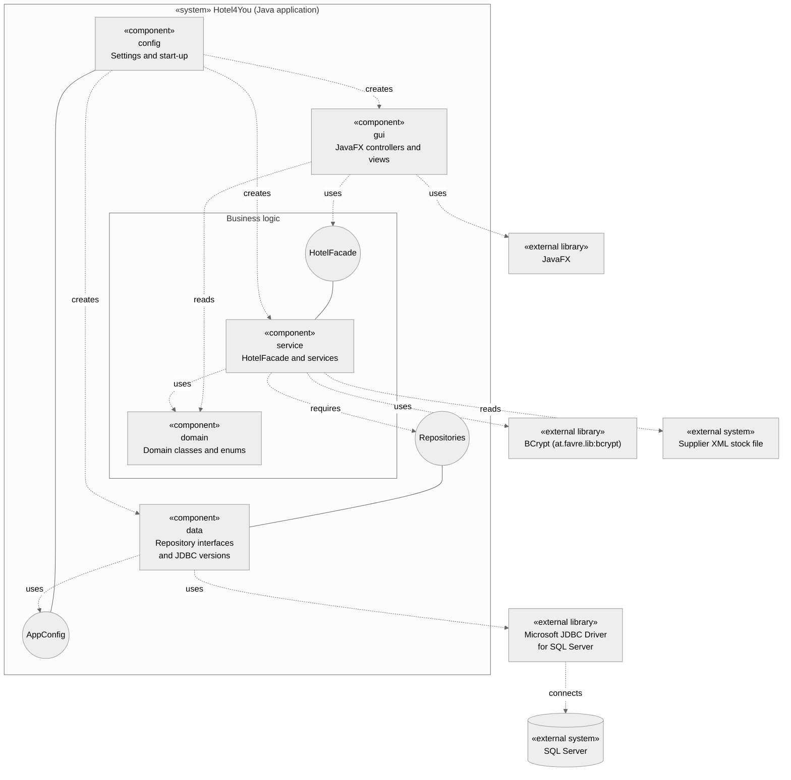

# H4Y-9 - Component Diagram

This diagram shows the main blocks of the application and the dependencies between them. Read [component-guide.md](component-guide.md) to explain the choices in class.

Sources: [statement](../../.agent/context/enunciado.md) sections 2 and 3, [requirements](../requirements/requirements.md), [class diagram](class-diagram.md), [classes](classes.md) and [schema](../database/schema.md). Package names come from H4Y-32 (project skeleton).

- **Requirements:** RF-28; RNF-02, RNF-05, RNF-06, RNF-07, RNF-08, RNF-10, RNF-11, RNF-12.

## Reading rules

- A box with `«component»` is one Java package of our code.
- A circle is an interface. A solid line from a component to a circle: the component provides the interface.
- A dashed arrow is a dependency ("uses"). It goes from the user to the provider.
- A box with `«external»` is a system or a library that the team does not write.
- Calls go one way: `gui` to `service` to `data`. `service` calls `data` only through the `Repositories` interface.
- `data` also uses the `domain` types. The arrow is not drawn, to keep the diagram easy to read. See the Components table.
- `config` is at the top because it starts the application. It holds no business rule.

## Components

| Component (package) | Content | Provides | Uses | Requirement IDs |
|---------------------|---------|----------|------|-----------------|
| `gui` | JavaFX controllers from the class diagram (`LoginController`, `RoomController`, `ReservationController` and the others) and their views. | Screens for the actors. | `HotelFacade`, `domain` (read only), JavaFX. | RNF-06, RNF-07 |
| `service` | `HotelFacade` and the services (`AuthService`, `RoomService`, `ReservationService`, `CardAccessService`, `StockService` and the others). All business rules. | `HotelFacade`. | `domain`, the repository interfaces in `data`, BCrypt. | RNF-02, RNF-07, RNF-08 |
| `domain` | Domain classes and enums (`User`, `Room`, `Reservation`, `MagneticCard`, `StockItem`, `Role` and the others). No SQL and no JavaFX. | Data types for the other packages. | None. | RNF-07, RNF-08 |
| `data` | Repository interfaces, for example `UserRepository`, and the JDBC versions for SQL Server. The JDBC version maps table rows to domain objects. Unit tests use an in-memory repository in `src/test`. | The repository interfaces. | `domain`, `AppConfig`, JDBC driver. | RNF-01, RNF-10, RNF-12 |
| `config` | Reads the database settings from a local file or the environment. Starts the application: creates the repositories and services and gives `HotelFacade` to `gui`. | `AppConfig`. | `gui`, `service`, `data`. | RNF-08, RNF-12 |

## Interfaces

| Interface | Provided by | Required by | Requirement IDs |
|-----------|-------------|-------------|-----------------|
| `HotelFacade` | `service` | `gui` | RNF-07 |
| Repositories (`UserRepository` and one for each other aggregate) | Declared in `data` (T0, H4Y-32). The JDBC versions come in H4Y-32 PR 2. | `service` | RNF-08, RNF-10, RNF-12 |
| `AppConfig` | `config` | `data` | RNF-12 |

## External systems and libraries

| Name | Type | Used by | Requirement IDs |
|------|------|---------|-----------------|
| SQL Server | External system | `data`, through JDBC | RNF-12 |
| Microsoft JDBC Driver for SQL Server (mssql-jdbc) | External library | `data`, through JDBC | RNF-11, RNF-12 |
| JavaFX | External library | `gui` | RNF-06, RNF-11 |
| BCrypt (`at.favre.lib:bcrypt`) | External library | `service` (`AuthService`) | RNF-02, RNF-11 |
| Supplier XML stock file | External system (file) | `service` (`StockService`) | RF-28 |
| JUnit | External library (tests only) | Test code. Not in the diagram: not part of the running application. | RNF-10, RNF-11 |

The justification of each library is in [component-guide.md](component-guide.md) and [libraries.md](../libraries.md).

## Gaps

These gaps need team review. They are not approved requirements.

| ID | Gap | Effect and next step |
|----|-----|----------------------|
| C-01 | The class diagram had no repository classes (G-01 in the sequence guide). | Partly closed. `UserRepository` exists in `data` and the class diagram shows it. The JDBC version comes in H4Y-32 PR 2. |
| C-02 | The password hash method was open (H4Y-29). | Closed. BCrypt (`at.favre.lib:bcrypt`) is chosen. It is in the external table and in `docs/libraries.md`. |
| C-04 | There was no Java code (H4Y-32). | Closed for the classes that exist now. The five packages exist in the Java code. The class-to-diagram check is done (architecture review, 2026-10-17). |
| C-03 | The package of `HotelFacade` was not named in H4Y-32. | Closed. `HotelFacade` is in `service`, as in the Java code. |

Created by: jmbcruz. Updated by: BorjaTiago. AI use: Cursor agent, Claude Opus 5.5, 2026-10-16; review fixes by Cursor agent, Claude Opus 5.5, 2026-10-16; docs-updater, Claude Code (claude-haiku-5-5), 2026-10-16; doc-updater, Claude Code (claude-haiku-5-5), 2026-10-17. Reviewed by: pending.
