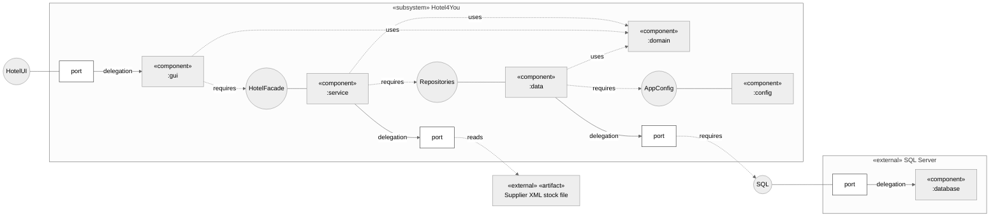

# H4Y-9 - Component Diagram

This diagram shows the main blocks of the application and the dependencies between them. Read [component-guide.md](component-guide.md) to explain the choices in class.

Sources: [statement](../../.agent/context/enunciado.md) sections 2 and 3, [requirements](../requirements/requirements.md), [class diagram](class-diagram.md), [classes](classes.md) and [schema](../database/schema.md). Package names come from H4Y-32 (project skeleton).

- **Requirements:** RF-28; RNF-02, RNF-05, RNF-06, RNF-07, RNF-08, RNF-10, RNF-11, RNF-12.

## Reading rules

The layout follows the teacher's component diagram slide (Moodle).

- The big box `«subsystem» Hotel4You` is the structured classifier. Its inside is the internal structure.
- A box `«component» :name` inside the subsystem is a part. Each part is one Java package of our code.
- A small box labelled `port` is a port. A port sits on the border of a subsystem or an external component.
- A circle is a provided interface (ball). A solid line joins the circle to the component that provides it.
- A dashed arrow labelled `requires` goes to the interface that a component needs. Mermaid cannot draw the socket, so this arrow is the socket. A required interface and a provided interface together are one assembly connector (ball and socket).
- A solid arrow labelled `delegation` is a delegation connector. It joins a port to the part that does the work.
- A box with `«external»` is outside our code. SQL Server is an external component. The supplier XML file is an external artifact.
- Libraries (JavaFX, JUnit) and the JDBC driver are not components. They are not in the diagram. See [libraries.md](../libraries.md).
- A dashed arrow labelled `uses` is a dependency. `gui`, `service` and `data` use the `domain` types.
- `config` creates all parts at start-up. These links are wiring, not dependencies, so they are not drawn.

## Components

| Component (package) | Content | Provides | Uses | Requirement IDs |
|---------------------|---------|----------|------|-----------------|
| `gui` | JavaFX controllers from the class diagram (`LoginController`, `RoomController`, `ReservationController` and the others) and their views. | `HotelUI` (screens for the actors), through the subsystem port. | `HotelFacade`, `domain` (read only). | RNF-06, RNF-07 |
| `service` | `HotelFacade` and the services (`AuthService`, `RoomService`, `ReservationService`, `CardAccessService`, `StockService` and the others). All business rules. | `HotelFacade`. | `domain`, the repository interfaces in `data`, the supplier XML file (through a port). | RNF-07, RNF-08 |
| `domain` | Domain classes and enums (`User`, `Room`, `Reservation`, `MagneticCard`, `StockItem`, `Role` and the others). No SQL and no JavaFX. | Data types for the other packages. | None. | RNF-07, RNF-08 |
| `data` | Repository interfaces, for example `UserRepository`, with one JDBC version for SQL Server and one in-memory version for tests (T0, H4Y-32). The JDBC version maps table rows to domain objects. | The repository interfaces. | `domain`, `AppConfig`, `SQL` of SQL Server (through a port). | RNF-01, RNF-10, RNF-12 |
| `config` | Reads the database settings from a local file or the environment. Starts the application: creates the repositories and services and gives `HotelFacade` to `gui`. The start-up links are not drawn. | `AppConfig`. | `gui`, `service`, `data` (start-up only). | RNF-08, RNF-12 |

## Interfaces

| Interface | Provided by | Required by | Requirement IDs |
|-----------|-------------|-------------|-----------------|
| `HotelFacade` | `service` | `gui` | RNF-07 |
| Repositories (`UserRepository` and one for each other aggregate) | Declared and implemented in `data` (T0, H4Y-32) | `service` | RNF-08, RNF-10, RNF-12 |
| `AppConfig` | `config` | `data` | RNF-12 |
| `HotelUI` | `gui`, through the subsystem port | The actors | RNF-06 |
| `SQL` | SQL Server (external) | `data`, through the subsystem port | RNF-12 |

## External components

| Name | Type | Used by | Requirement IDs |
|------|------|---------|-----------------|
| SQL Server | External component. Provides `SQL`. | `data`, through a port | RNF-12 |
| Supplier XML stock file | External artifact (file) | `service` (`StockService`), through a port | RF-28 |

JavaFX, the Microsoft JDBC Driver for SQL Server and JUnit are libraries. A library is not a component (teacher feedback, H4Y-9, 2026-10-17). They are listed with their reasons in [libraries.md](../libraries.md) and [component-guide.md](component-guide.md).

## Gaps

These gaps need team review. They are not approved requirements.

| ID | Gap | Effect and next step |
|----|-----|----------------------|
| C-01 | The class diagram has no repository classes (G-01 in the sequence guide). | This diagram adds the `data` package and the repository interfaces from H4Y-32. Update the class diagram when H4Y-32 adds the repositories. |
| C-02 | The password hash method is open (H4Y-29). | No hash library is chosen yet. If H4Y-29 picks a library, add it to `docs/libraries.md`. It is not a component. |
| C-04 | There is no Java code yet. | The package-to-code check is pending. Do it when H4Y-32 adds the Java files. |
| C-03 | The package of `HotelFacade` is not named in H4Y-32. | The diagram puts it in `service`. Confirm in H4Y-32. |

Created by: jmbcruz. Updated by: jmbcruz. AI use: Cursor agent, Claude 2026-10-16; review fixes by Cursor agent, Claude, 2026-10-16; docs-updater, Claude Code (claude-haiku-5-5), 2026-10-16; teacher feedback fixes by jmbcruz with Claude Code, 2026-10-21. Reviewed by: pending.
