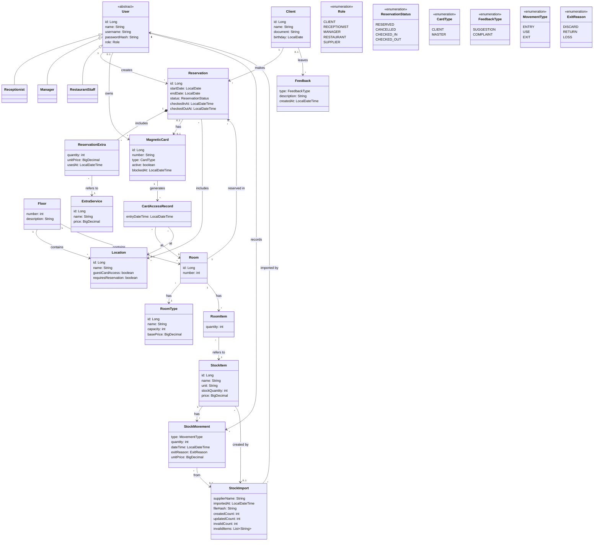

# Hotel4You - Domain Model

This document shows the business concepts of H4Y (Hotel4You). It has no controllers, facade or services. It has no methods. It comes from [class-diagram.md](class-diagram.md), [classes.md](classes.md) and the [glossary](../requirements/glossary.md).

## Diagram

## Concepts

| Concept | Meaning | Main attributes |
|---------|---------|-----------------|
| User | Staff member who logs in. It is abstract. | name, username, passwordHash, role |
| Receptionist | User who does reservations, check-in, check-out and cards. | (from User) |
| Manager | User who manages rooms, prices, staff, stock and the master magnetic card. | (from User) |
| RestaurantStaff | User of the restaurant. | (from User) |
| Client | Hotel guest. | name, document, birthday |
| Floor | Floor of the hotel (-1, 0, 1, 2, 3). | number, description |
| Location | Hotel place with card access, such as restaurant, pool, garage or conference room. | name, guestCardAccess, requiresReservation |
| Room | Sleeping room on a floor. | number |
| RoomType | Type of room with its capacity and base price per night. | name, capacity, basePrice |
| RoomItem | Quantity of a stock item set in a room (Room item). | quantity |
| Reservation | Booking of a room by a client for one or more nights. | startDate, endDate, status, checkedInAt, checkedOutAt |
| ExtraService | Service that adds to the price (Extra service). | name, price |
| ReservationExtra | Use of an extra service in a reservation. It keeps the price at the time. | quantity, unitPrice, usedAt |
| MagneticCard | Magnetic card with a number. Type CLIENT or MASTER (Master magnetic card). | number, type, active, blockedAt |
| CardAccessRecord | Saved record of a card entry (Card access record). | entryDateTime |
| StockItem | Material stored in the hotel (Stock). | name, unit, stockQuantity, price |
| StockMovement | Entry, use or exit of a stock item. | type, quantity, dateTime, exitReason, unitPrice |
| StockImport | Import of a supplier XML file. | supplierName, importedAt, fileHash, createdCount, updatedCount, invalidCount, invalidItems |
| Feedback | Suggestion or complaint of a client. | type, description, createdAt |
| Role | Enum: CLIENT, RECEPTIONIST, MANAGER, RESTAURANT, SUPPLIER. | - |
| ReservationStatus | Enum: RESERVED, CANCELLED, CHECKED_IN, CHECKED_OUT. | - |
| CardType | Enum: CLIENT, MASTER. | - |
| FeedbackType | Enum: SUGGESTION, COMPLAINT. | - |
| MovementType | Enum: ENTRY, USE, EXIT. | - |
| ExitReason | Enum: DISCARD, RETURN, LOSS. | - |

## Business rules

- A card owner is 0..1. A card belongs to a reservation (client card) OR to a staff user (master card), never both.
- A master magnetic card belongs to a Manager. It opens all client rooms and all zones.
- A client card opens the room. It opens the restaurant and pool only if the reservation includes them.
- A reservation belongs to one client, one room and one user who created it.
- Only the manager deletes a reservation, and only before check-in. Reception cancels a reservation.
- A reservation extra keeps the unit price at the time of use. Later price changes do not change it.
- A room has one room type. The base price comes from the room type. Extras add to it.
- A card access record points to a room or a location (each 0..1).
- A stock movement of type EXIT has an exit reason (DISCARD, RETURN or LOSS).
- A stock movement from an XML import points to its stock import. The entry copies the unit price at that time. The stock import keeps the counters and the format-invalid items. A stock item made by an import points to it. The same file (same hash) cannot be imported twice: the system refuses it, records nothing, and shows an error message (no stock import). The import is an upsert (Q-48). Each XML item has a mandatory name, quantity, unit and price. An existing item (same name, trimmed, case-insensitive) with the same unit gets an entry and a new price. A different unit is format-invalid. A new item is created with the XML unit. A missing or invalid unit or price is format-invalid.
- A client may leave many feedbacks. The client link is 0..1.

AI use: Claude Code agent, Claude Sonnet 5.5, 2026-10-16. Also edited by doc-updater, Claude Sonnet 5.5, 2026-10-16. XML unit/price rule by docs-updater, Claude Code (claude-haiku-5-5), 2026-10-16. Reviewed by: pending.
