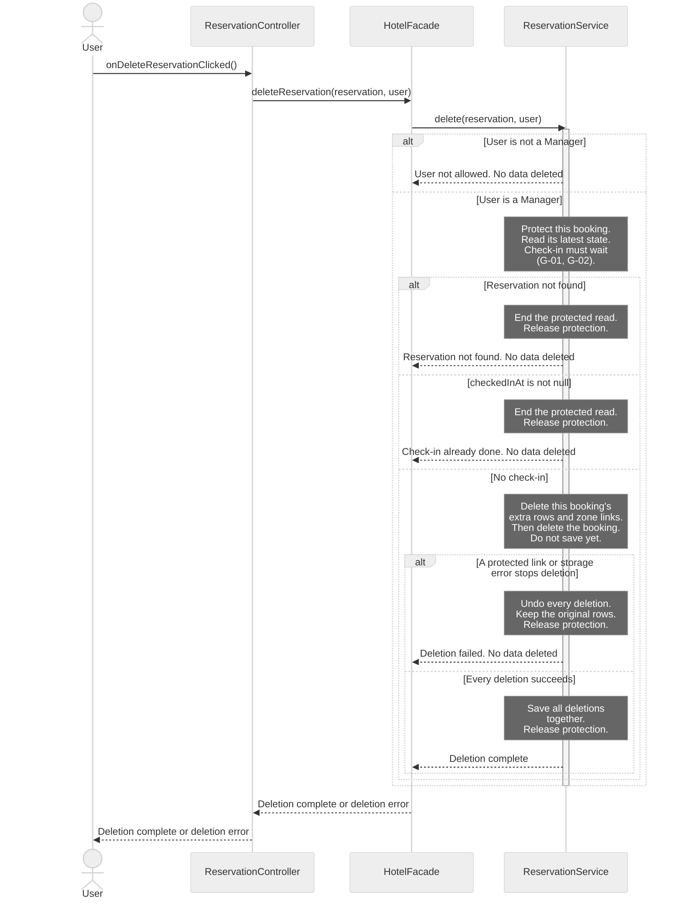
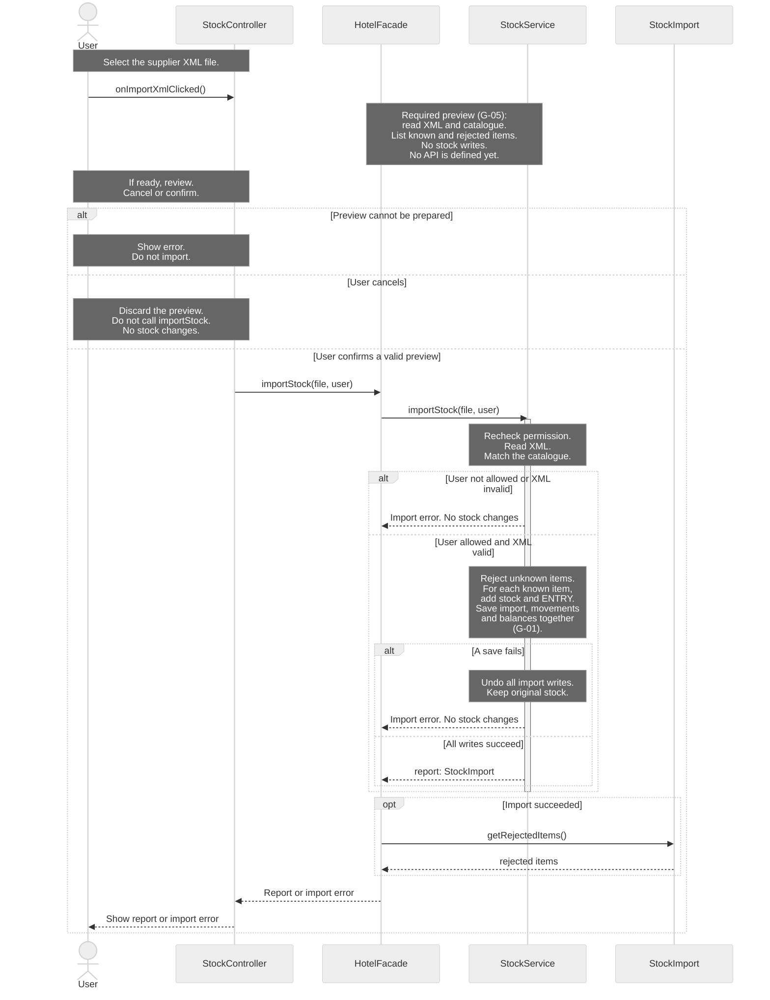

# H4Y-8 - Sequence Diagrams

These diagrams show calls between the classes in [classes.md](classes.md) and [class-diagram.md](class-diagram.md). This file contains the current sequence changes and their limits. The separate sequence guide still describes the earlier card flow.

Sources: [use cases](../requirements/use-cases.md), [requirements](../requirements/requirements.md), [domain model](domain-model.md), [schema](../database/schema.md) and [table guide](../database/tables.md). The source baseline is `origin/main` at `4741c61`. The [PR #20 review](https://github.com/BorjaTiago/hotel4you/pull/20#issuecomment-6265012673) requests an XML preview, confirmation and report. It replaces the simpler SD-05 with SD-06. Diagram IDs are not reassigned.

## Reading rules

- Time goes from top to bottom. Solid arrows are method calls. Dashed arrows show data, errors or completion. A completion signal does not change a `void` return type.
- Each actor and participant uses a class name from the class diagram. Short IDs only make the source easier to read.
- A controller calls `HotelFacade`. The facade calls a service. Services hold business rules. Controllers never call SQL Server.
- Notes describe internal work or an explicitly marked missing contract. They are not new methods. Only call arrows claim method coverage.
- SQL Server work appears in notes. The class model has no database or repository class with methods. See G-01.
- Each diagram covers one existing use case. SD-04 is detailed. SD-06 is a general view of the import workflow. It keeps parsing and storage details in notes.
- The class model has only the one-step `importStock()` API. The read-only preview is marked as a missing contract (G-05), not a method call. No preview class or method is added to the class model.
- Unknown XML items remain rejected under Q-10 and Q-38. The review's meaning of "new items" needs clarification before any catalogue creation is added.
- A lifeline shows a participant in one scenario. It does not set the number of cards or records. See the cardinality review below.

## SD-04 - Detailed: delete a reservation

- **Use case name:** UC-05 Delete reservation.
- **Actor:** Manager. Other signed-in `User` roles exercise the denied branch.
- **Goal:** Delete a booking and its dependent rows only before check-in.
- **Preconditions:** The caller is signed in. The selected booking may be missing or stale. The service must read its current state.
- **Requirements:** RF-02, RF-22; RNF-07, RNF-12.

**Error cases covered:** User is not a manager. The booking is missing. Check-in has occurred, including a completed stay. A protected card link or storage error stops deletion. Every failure keeps the original data.

The deletion steps are internal work of `ReservationService.delete()`. They are not extra method calls. Delete only this booking's `reservation_services` rows and `reservation_locations` links. Keep the shared room, locations and service catalogue. Never delete cards or access history to force a booking deletion.

A transaction groups the deletions: save them all, or undo them all. A lock protects the current booking while the service checks and deletes it. Check-in must respect the same protection. A transaction alone does not prevent a concurrent check-in. These persistence contracts remain G-01 and G-02.

Example: booking R17 has two extra rows and one pool link. Success deletes those three rows and the booking together. The room, pool and service catalogue remain. If the booking delete fails, undo all four deletions. Release the booking protection only after save or undo finishes.

Deletion is permanent (Q-05). `cancel()` keeps the booking in history. Neither operation is a user deactivation flag.

## SD-06 - General: review and import supplier XML

- **Use case name:** UC-15 Enter supplier delivery in stock.
- **Actor:** A signed-in hotel staff user or Manager. The supplier sends the XML and does not log in (Q-17).
- **Goal:** Review a supplier file. Import valid catalogue items only after confirmation. Show the result and rejected items.
- **Preconditions:** The user selected an XML file. The stock catalogue exists (UC-19). The service must check the user's permission. A preview changes no stock.
- **Requirements:** RF-28, RF-29; RNF-07, RNF-08. Review flow: PR #20 comment. Catalogue rules: Q-10 and Q-38.

This general view shows file review, cancel, confirm and report. The preview note marks a required stage with no API in the current class model (G-05). It does not claim that `importStock()` can return a preview. The existing import method runs only after the user's confirmation. `StockImport` is the saved import report.

The review's "new items" appear as unknown catalogue items, separate from known items for restock. They are not created or imported. This follows RF-28, Q-10 and Q-38. A catalogue item with zero stock is still known. Creating a catalogue item is UC-19, outside this diagram. G-05 records the unclear part of the review.

**Error cases covered:** Preview preparation fails (pending G-05). User not allowed, including loss of permission before import. Invalid XML. Unknown catalogue items. A storage failure. Cancel is an alternative flow and saves nothing. The current API does not define stale-preview or duplicate-confirmation checks; these remain G-05.

**Report:** The saved `StockImport` gives the supplier, import time and rejected items. Its ENTRY movements give the accepted item quantities. A valid file with only unknown items adds no stock and reports all items as rejected. No new catalogue item is created.

**Preview boundary:** The note before the user decision specifies the requested read-only review. Its service API is missing, so the diagram cannot claim a complete executable preview flow. The controller must not parse business data or query the catalogue itself. G-05 needs a read-only business contract and a way to bind the import to the reviewed file. The existing `importStock(file, user)` rechecks data when it imports. It has no preview ID or one-time confirmation parameter. No protection against a changed file or duplicate import is claimed here. Cancel invokes no import call.

Example: soap has balance 10 and towels have balance 0. Both are catalogue items. An XML delivery contains soap +5, towels +3 and an unknown item. After confirmation, success saves balances 15 and 3, two ENTRY movements and one import report. The unknown item stays rejected. Cancel or a failed save leaves balances 10 and 0.

## Cardinality review

These counts describe the existing UML model. A sequence lifeline represents one participant in the scenario, not the number of stored objects. The review changes no class association, database constraint or index.

| Relationship | Existing multiplicity | Effect on the sequence |
|--------------|-----------------------|------------------------|
| Reservation and ReservationExtra | One booking has `0..*` extra rows; each row has one booking. | SD-04 removes the selected booking's rows only. |
| Reservation and Location | `0..*` on both sides, through link rows. | SD-04 removes links, not shared locations. |
| Reservation and MagneticCard | `0..1` on both sides in UML. | SD-04 does not delete a card to bypass a protected link. |
| StockItem and StockMovement | One item per movement; `0..*` movements per item. | Each accepted XML line adds an ENTRY movement. |
| StockImport and StockMovement | `0..*` movements per import; `0..1` import per movement. | XML movements share an import. A report with only rejected items can have no movements. |
| User and StockImport | One user per import; `0..*` imports per user. | The supplier does not log in. The authorized hotel user records the import. |

## Traceability

Each call below names a method of its receiving class. Dashed arrows show data, errors or completion. They are not new methods. See [classes.md](classes.md) and [class-diagram.md](class-diagram.md).

| Use case | Diagram | Class methods used | Requirement IDs |
|----------|---------|--------------------|-----------------|
| UC-05 Delete reservation | SD-04 (detailed) | `ReservationController.onDeleteReservationClicked`; `HotelFacade.deleteReservation`; `ReservationService.delete` | RF-02, RF-22; RNF-07, RNF-12 |
| UC-15 Enter supplier delivery in stock | SD-06 (general, preview note, cancel, import after confirmation and report) | `StockController.onImportXmlClicked`; `HotelFacade.importStock`; `StockService.importStock`; `StockImport.getRejectedItems` | RF-28, RF-29; RNF-07, RNF-08 |

## Gaps

These contracts need team review. No absent method is used as a call arrow. G-05 identifies the preview contract missing from the current class model. The class model, requirements and database documents are unchanged by this PR.

| ID | Gap | Effect and next step |
|----|-----|----------------------|
| G-01 | No persistence classes or methods | Define protected reads, save, delete and transaction contracts. SD-04 needs all deletions saved together or fully undone. Check-in and deletion must respect the same booking lock. SD-06 needs the import, ENTRY movements and stock balances saved together. |
| G-02 | The current reservation read is not explicit | Read the booking after acquiring protection. Keep that protection until save or undo finishes. If check-in finishes first, the read must see it and refuse deletion. Do not invent a lookup or lock method. |
| G-03 | No card reader or door adapter | Retained outside the current two diagrams. Define the reader event, door command and event after real entry before card implementation. JavaFX controllers must still use the facade. |
| G-04 | Denied audit has no outcome | `CardAccessRecord` and `access_logs` lack an outcome. `register()` accepts none. Q-49 asks whether denied attempts need audit. An approved contract must distinguish refusals from entries. |
| G-05 | No read-only XML preview or reviewed-file binding | The existing `importStock(file, user)` imports immediately. It cannot prepare a cancellable preview. SD-06 marks that missing stage in a note and calls the real import method only after confirmation. A later class-model task must define preview data, authorization, reviewed-file identity and duplicate-confirmation behavior. Clarify whether "new items" means known items with zero stock or automatic catalogue creation. Until then, Q-10 and Q-38 require rejection of unknown items. No new class, method or requirement is added here. |

## Validation boundary

There are two diagrams: SD-04 detailed and SD-06 general. SD-05 is replaced after PR review. Only this sequence file changes against `main`. All call arrows use public methods already in the unchanged class model. The XML preview remains an explicit gap, not a completed API design. Persistence and physical reader contracts also remain incomplete. Q-49 stays open outside these diagrams. Human review is required.

Created by: pedrocostaisep. Updated by: pedrocostaisep. AI use: sequence-diagram-editor, OpenAI Codex (GPT-6), 2026-10-16; PR review corrections by sequence-diagram-editor, OpenAI Codex (GPT-6), 2026-10-16. teacher feedback corrections by sequence-diagram-editor, OpenAI Codex (GPT-6), 2026-10-19; PR-20 stock import review by sequence-diagram-editor, OpenAI Codex (GPT-6), 2026-10-19; sequence-only scope correction by sequence-diagram-editor, OpenAI Codex (GPT-6), 2026-10-21. Reviewed by: pending.
