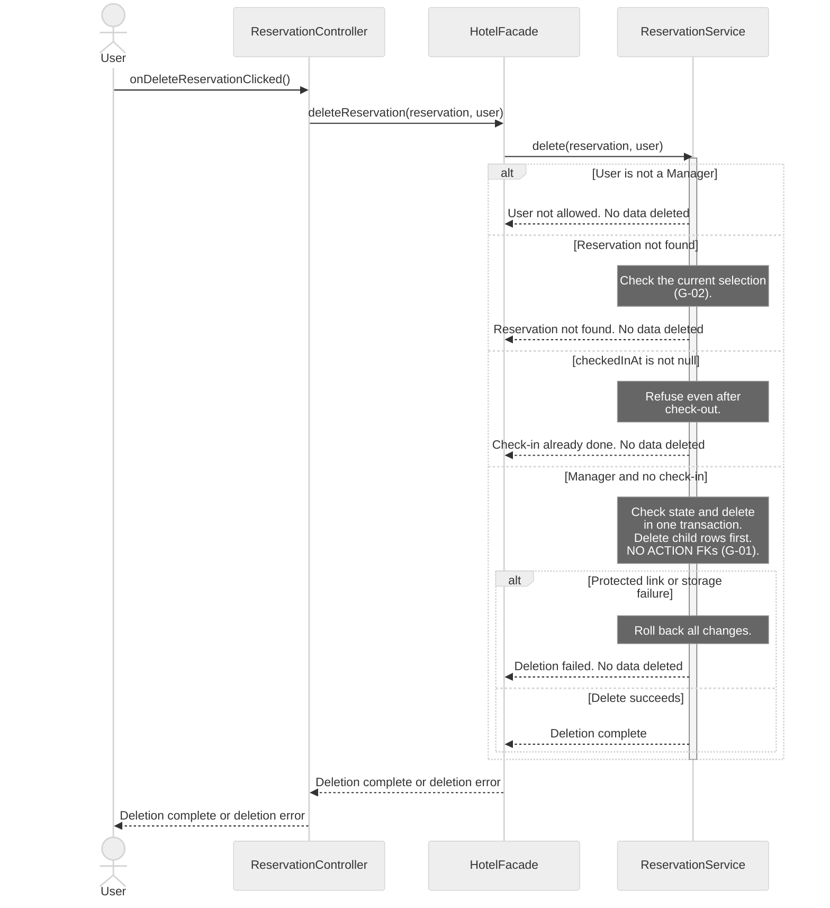
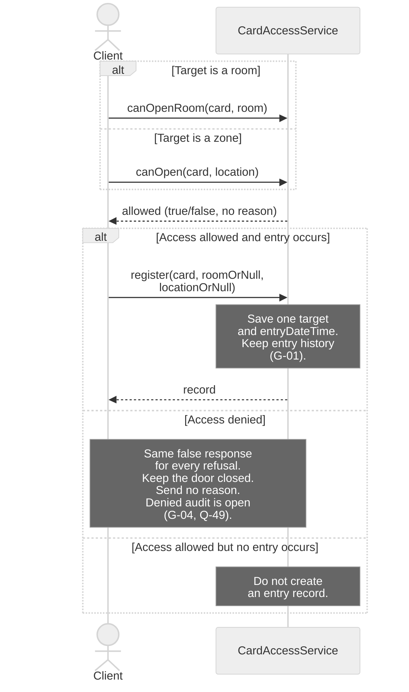

# H4Y-8 - Sequence Diagrams

These diagrams show calls between the classes in [classes.md](classes.md) and [class-diagram.md](class-diagram.md). Read [sequence-guide.md](sequence-guide.md) to explain the choices in class.

Sources: [use cases](../requirements/use-cases.md), [requirements](../requirements/requirements.md), [domain model](domain-model.md), [schema](../database/schema.md) and [table guide](../database/tables.md). The source baseline is `origin/main` at `6efffff`.

## Reading rules

- Time goes from top to bottom. Solid arrows are method calls. Dashed arrows show data, errors or completion. A completion signal does not change a `void` return type.
- Each actor and participant uses a class name from the class diagram. Short IDs only make the source easier to read.
- A controller calls `HotelFacade`. The facade calls a service. Services hold business rules. Controllers never call SQL Server.
- Notes describe checks and data changes within an existing method. They are not new methods. Only call arrows claim method coverage.
- SQL Server work appears in notes. The class model has no database or repository class with methods, except `UserRepository` (H4Y-32). See G-01.
- Each diagram covers one existing use case. SD-04 is detailed. SD-05 is a general view at the service boundary.
- SD-05 omits internal permission checks and storage steps. Its tables explain the role variants.
- Denied access audit needs a decision. See Q-49 in [questions.md](../requirements/questions.md) and G-04 below.

## SD-04 - Detailed: delete a reservation

- **Use case name:** UC-05 Delete reservation.
- **Actor:** Manager. Other signed-in `User` roles exercise the denied branch.
- **Goal:** Delete a reservation only before check-in.
- **Preconditions:** The caller is signed in. The selected reservation may be missing or stale. The service must check its current state.
- **Requirements:** RF-02, RF-22; RNF-07, RNF-12.

**Error cases covered:** User is not a manager. The reservation is missing. Check-in has already occurred. A protected link or storage failure blocks deletion. Each branch returns an explicit result.

Deletion is permanent (Q-05). `cancel()` keeps the reservation in history. Neither operation is a user deactivation flag. The service must check the current arrival state in the delete transaction. This prevents a concurrent check-in from invalidating the decision.

## SD-05 - General: use a magnetic card and log entry

- **Use case name:** UC-09 Use magnetic card at a place.
- **Actor:** Client in the main flow. Manager, Receptionist and RestaurantStaff use the role variants below. The restaurant restriction comes from UC-17.
- **Goal:** Show the access decision and the record of a real entry.
- **Preconditions:** The card and target are known. Exactly one of `roomOrNull` and `locationOrNull` has a value. A client card links to its reservation. A staff card links to its user.
- **Requirements:** RF-17, RF-18, RF-19, RF-23, RF-24, RF-25; RNF-07.

This general view shows the service boundary for UC-09. It omits internal permission checks and storage steps. The tables below describe the role variants and internal refusal reasons.

Actor arrows stand for the card reader boundary. They are not JavaFX controller calls. The reader, door command and real-entry event are missing contracts (G-03).

**Error cases covered:** Inactive card. Blocked card. Another guest's room. Restaurant or pool not included in the reservation. Zone closed to client cards. Staff access outside the allowed floors or zones.

Every refusal returns the same `false` value. The reader receives no reason. This rule applies to client and staff cards. The reasons below describe internal checks only.

| Internal refusal reason | Response to the reader |
|-------------------------|------------------------|
| Card is inactive or blocked | `false`, no reason |
| Room belongs to another guest | `false`, no reason |
| Restaurant or pool is not included | `false`, no reason |
| Zone is closed to client cards | `false`, no reason |
| Staff role cannot access the target | `false`, no reason |

Check `active` and `blockedAt` before the role rules. The same entry flow applies to staff and master cards. Each successful entry saves its target and time.

| Card owner | Room rule | Zone rule |
|------------|-----------|-----------|
| Client | Own reserved room only | `guestCardAccess` must be true. If `requiresReservation` is true, the reservation must include the zone. |
| Manager with master card | Every room | Every zone |
| Receptionist | No guest room | Floors 0 and 1 only |
| RestaurantStaff | No guest room | Kitchen and restaurant only |
| Any blocked or inactive card | Refuse | Refuse |

Denied audit is pending. `register()` and `access_logs` have no outcome field. A denied attempt must not appear as a real entry (G-04, Q-49).

## Traceability

Each call below names a method of its receiving class. Dashed arrows show data, errors or completion. They are not new methods. See [classes.md](classes.md) and [class-diagram.md](class-diagram.md).

| Use case | Diagram | Class methods used | Requirement IDs |
|----------|---------|--------------------|-----------------|
| UC-05 Delete reservation | SD-04 (detailed) | `ReservationController.onDeleteReservationClicked`; `HotelFacade.deleteReservation`; `ReservationService.delete` | RF-02, RF-22; RNF-07, RNF-12 |
| UC-09 Use magnetic card at a place; UC-17 supplies the staff restriction | SD-05 (general) | `CardAccessService.canOpenRoom`, `canOpen`, `register` | RF-17, RF-18, RF-19, RF-23, RF-24, RF-25; RNF-07 |

## Gaps

These gaps need class model review. They are not approved methods or new requirements. No missing method is used as a call arrow. The class model and database files are unchanged. Gap IDs stay stable after the scope reduction.

| ID | Gap | Effect and next step |
|----|-----|----------------------|
| G-01 | No persistence classes or methods, except `UserRepository` (H4Y-32) | Define read, save, delete and transaction contracts. SD-04 needs a protected delete transaction. SD-05 needs entry storage. SQL Server work appears in notes. |
| G-02 | The current reservation read is not explicit | SD-04 must load the current reservation and check its arrival state in the delete transaction. Define that read contract. No lookup method is invented. |
| G-03 | No card reader or door adapter | Define the reader event, door command and event after real entry. SD-05 shows only the existing service API. A JavaFX controller must still use the facade. |
| G-04 | Denied audit has no outcome | `CardAccessRecord` and `access_logs` lack an outcome. `register()` accepts none. Q-49 asks whether denied attempts need audit. An approved contract must distinguish refusals from entries. |

## Validation boundary

The two diagrams cover one general view and one detailed view. Mermaid and method checks validate the documents. They do not validate an implementation. Error types, persistence and physical reader contracts remain incomplete. Q-49 remains open. Human review is still required.

Created by: pedrocostaisep. Updated by: BorjaTiago. AI use: sequence-diagram-editor, OpenAI Codex (GPT-6), 2026-10-16; PR review corrections by sequence-diagram-editor, OpenAI Codex (GPT-6), 2026-10-16; doc-updater, Claude Code (claude-haiku-5-5), 2026-10-17. Reviewed by: pending.
