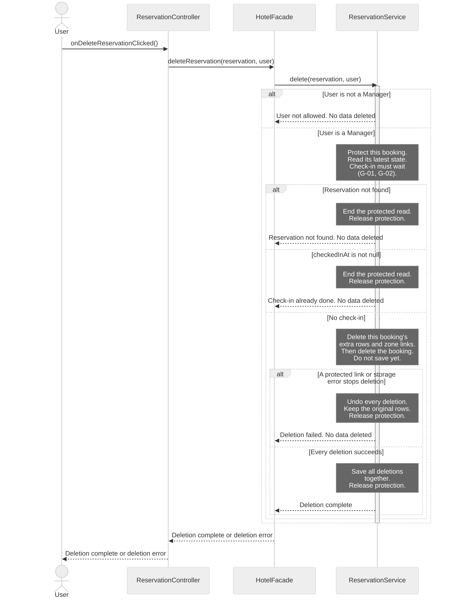
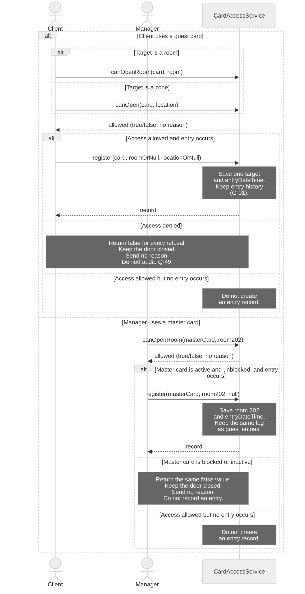

# H4Y-8 - Sequence Diagrams

These diagrams show calls between the classes in [classes.md](classes.md) and [class-diagram.md](class-diagram.md). Read [sequence-guide.md](sequence-guide.md) to explain the choices in class.

Sources: [use cases](../requirements/use-cases.md), [requirements](../requirements/requirements.md), [domain model](domain-model.md), [schema](../database/schema.md) and [table guide](../database/tables.md). The source baseline is `origin/main` at `4741c61`.

## Reading rules

- Time goes from top to bottom. Solid arrows are method calls. Dashed arrows show data, errors or completion. A completion signal does not change a `void` return type.
- Each actor and participant uses a class name from the class diagram. Short IDs only make the source easier to read.
- A controller calls `HotelFacade`. The facade calls a service. Services hold business rules. Controllers never call SQL Server.
- Notes describe checks and data changes within an existing method. They are not new methods. Only call arrows claim method coverage.
- SQL Server work appears in notes. The class model has no database or repository class with methods. See G-01.
- Each diagram covers one existing use case. SD-04 is detailed. SD-05 is a general view at the service boundary.
- SD-05 omits internal permission checks and storage steps. Its tables explain the role variants.
- Denied access audit needs a decision. See Q-49 in [questions.md](../requirements/questions.md) and G-04 below.
- A lifeline shows a participant in one scenario. It does not set the number of cards or records. See the cardinality review in the guide.

## SD-04 - Detailed: delete a reservation

- **Use case name:** UC-05 Delete reservation.
- **Actor:** Manager. Other signed-in `User` roles exercise the denied branch.
- **Goal:** Delete a booking and its dependent rows only before check-in.
- **Preconditions:** The caller is signed in. The selected booking may be missing or stale. The service must read its current state.
- **Requirements:** RF-02, RF-22; RNF-07, RNF-12.

**Error cases covered:** User is not a manager. The booking is missing. Check-in has occurred, including a completed stay. A protected card link or storage error stops deletion. Every failure keeps the original data.

The deletion steps are internal work of `ReservationService.delete()`. They are not extra method calls. Delete only this booking's `reservation_services` rows and `reservation_locations` links. Keep the shared room, locations and service catalogue. Never delete cards or access history to force a booking deletion.

A transaction groups the deletions: save them all, or undo them all. A lock protects the current booking while the service checks and deletes it. Check-in must respect the same protection. A transaction alone does not prevent a concurrent check-in. These persistence contracts remain G-01 and G-02. The [guide](sequence-guide.md) gives the example and failure order.

Deletion is permanent (Q-05). `cancel()` keeps the booking in history. Neither operation is a user deactivation flag.

## SD-05 - General: use a magnetic card and log entry

- **Use case name:** UC-09 Use magnetic card at a place.
- **Actor:** Client or Manager. Receptionist and RestaurantStaff retain the role rules below. The restaurant restriction comes from UC-17.
- **Goal:** Show client access and master-card access, then record each real entry.
- **Preconditions:** The card and target are known. Exactly one of `roomOrNull` and `locationOrNull` has a value. A guest card links to a reservation. A master card links to its manager, with no reservation link.
- **Requirements:** RF-17, RF-18, RF-19, RF-23, RF-24, RF-25, RF-30; RNF-07. Master-card rules: Q-19, Q-26, Q-31.

This general view stops at the service boundary. It has two scenarios within UC-09. The client uses a guest card. The manager uses a master card at another guest's room. The service decides access in both cases.

Actor arrows stand for the card reader boundary. They are not JavaFX controller calls. The reader, door command and real-entry event remain missing contracts (G-03).

**Error cases covered:** Inactive or blocked guest card. Another guest's room. Restaurant or pool not included in the booking. Zone closed to guest cards. Staff access outside the allowed floors or zones. A blocked or inactive master card is also refused.

**New concrete scenario:** Ana occupies room 202. The manager has no reservation for that room. An active, unblocked master card still permits entry. At 10:00, `register(masterCard, room202, null)` records room 202 and the real entry time. The same card is refused if it is blocked or inactive. This is an access variant of UC-09; no card blocking or replacement operation is added.

Every refusal returns the same `false` value. The reader receives no reason. The labels and table below describe internal checks only.

| Internal refusal reason | Response to the reader |
|-------------------------|------------------------|
| Card is inactive or blocked, including a master card | `false`, no reason |
| Room belongs to another guest and the card is a guest card | `false`, no reason |
| Restaurant or pool is not included | `false`, no reason |
| Zone is closed to guest cards | `false`, no reason |
| Staff role cannot access the target | `false`, no reason |

Check `active` and `blockedAt` before the role rules. Each real entry uses the same log contract. A card issue or an access check alone does not create an entry record.

| Card owner | Room rule | Zone rule |
|------------|-----------|-----------|
| Client | Own reserved room only | `guestCardAccess` must be true. If `requiresReservation` is true, the reservation must include the zone. |
| Manager with master card | Every room | Every zone |
| Receptionist | No guest room | Floors 0 and 1 only |
| RestaurantStaff | No guest room | Kitchen and restaurant only |
| Any blocked or inactive card | Refuse | Refuse |

Denied audit remains open in Q-49 and G-04. `register()` and `access_logs` have no outcome field. A denied attempt must not appear as a real entry.

## Traceability

Each call below names a method of its receiving class. Dashed arrows show data, errors or completion. They are not new methods. See [classes.md](classes.md) and [class-diagram.md](class-diagram.md).

| Use case | Diagram | Class methods used | Requirement IDs |
|----------|---------|--------------------|-----------------|
| UC-05 Delete reservation | SD-04 (detailed) | `ReservationController.onDeleteReservationClicked`; `HotelFacade.deleteReservation`; `ReservationService.delete` | RF-02, RF-22; RNF-07, RNF-12 |
| UC-09 Use magnetic card at a place; UC-17 supplies the staff restriction | SD-05 (general, client and master-card scenarios) | `CardAccessService.canOpenRoom`, `canOpen`, `register` | RF-17, RF-18, RF-19, RF-23, RF-24, RF-25, RF-30; RNF-07 |

## Gaps

These contracts need class model review. They are not approved methods or new business requirements. No missing method is used as a call arrow. The cardinality corrections are documented in the [guide](sequence-guide.md#cardinality-review).

| ID | Gap | Effect and next step |
|----|-----|----------------------|
| G-01 | No persistence classes or methods | Define protected reads, save, delete and transaction contracts. SD-04 needs all deletions saved together or fully undone. Check-in and deletion must respect the same booking lock. SD-05 needs real-entry storage. |
| G-02 | The current reservation read is not explicit | Read the booking after acquiring protection. Keep that protection until save or undo finishes. If check-in finishes first, the read must see it and refuse deletion. Do not invent a lookup or lock method. |
| G-03 | No card reader or door adapter | Define the reader event, door command and event after real entry. SD-05 shows the existing service API for client and manager scenarios. JavaFX controllers must still use the facade. |
| G-04 | Denied audit has no outcome | `CardAccessRecord` and `access_logs` lack an outcome. `register()` accepts none. Q-49 asks whether denied attempts need audit. An approved contract must distinguish refusals from entries. |

## Validation boundary

There are two diagrams: one general and one detailed. Cardinality is reviewed in the guide. The database documents now express the existing one-card-per-reservation rule. No database script or application code implements these changes in this task. Error, persistence and physical reader contracts remain incomplete. Q-49 stays open. Human review is required.

Created by: pedrocostaisep. Updated by: pedrocostaisep. AI use: sequence-diagram-editor, OpenAI Codex (GPT-6), 2026-10-16; PR review corrections by sequence-diagram-editor, OpenAI Codex (GPT-6), 2026-10-16. teacher feedback corrections by sequence-diagram-editor, OpenAI Codex (GPT-6), 2026-10-19. Reviewed by: pending.
