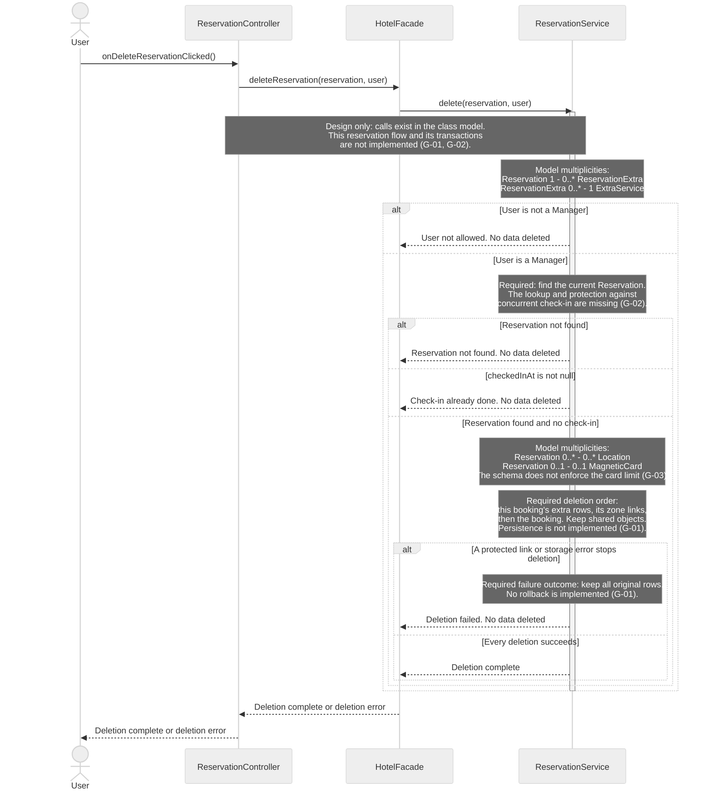
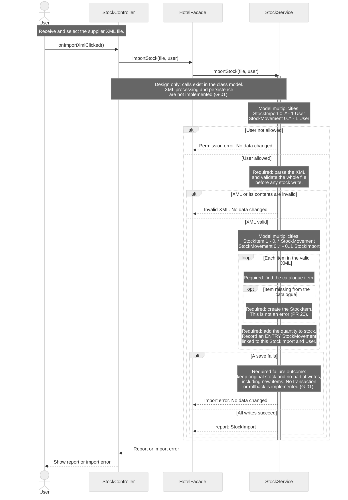

# H4Y-8 - Sequence Diagrams

These diagrams show calls between the classes in [classes.md](classes.md) and [class-diagram.md](class-diagram.md). Read [sequence-guide.md](sequence-guide.md) to defend the flows and their limits.

Sources: [use cases](../requirements/use-cases.md), [requirements](../requirements/requirements.md), [domain model](domain-model.md), [schema](../database/schema.md) and [table guide](../database/tables.md). This carry-over review uses `origin/main` at `44ccc4d`. The latest [PR #20 decision](https://github.com/BorjaTiago/hotel4you/pull/20#issuecomment-6322549129), dated 2026-10-21, replaces the earlier preview request: import all items from a valid XML file and create missing catalogue items. SD-06 replaces the simpler SD-05 card flow. Diagram IDs are not reassigned.

## Reading rules

- Time goes from top to bottom. Solid arrows are method calls. Dashed arrows show data, errors or completion. A completion signal does not change a `void` return type.
- Each actor and participant uses a class name from the class diagram. Short IDs only make the source easier to read.
- A controller calls `HotelFacade`. The facade calls a service. Services hold business rules. Controllers never call SQL Server.
- Notes describe required internal work, model multiplicities or a missing contract. They are not new methods. Only call arrows claim method coverage.
- SQL Server work appears in notes. The class model includes `Database`, `UserRepository` and `JdbcUserRepository` (H4Y-32). It has no persistence contracts for reservations or stock. See G-01.
- Each diagram covers one existing use case. SD-04 is detailed. SD-06 is a general view of the import workflow. It keeps parsing and storage details in notes.
- SD-06 uses the existing one-step `importStock()` API. It has no preview or confirmation stage.
- The latest PR decision accepts every item from a valid XML file, including items missing from the catalogue. This replaces the earlier unknown-item rejection rule for this flow.
- A lifeline shows a participant in one scenario. It does not set the number of stored objects. Notes inside each diagram show the relevant model multiplicities. `*` in the canonical UML is written as `0..*` here.

**Implementation boundary:** Both sequences are design flows. The six called methods exist in the class model. The reservation and stock controllers, service operations and persistence flows are not implemented in Java at this baseline. No implemented transaction, lock, commit or rollback is shown. Error and success branches describe required outcomes, not tested runtime behavior (G-01, G-02).

## SD-04 - Detailed: delete a reservation

- **Use case name:** UC-05 Delete reservation.
- **Actor:** Manager. Other signed-in `User` roles exercise the denied branch.
- **Goal:** Delete a booking and its dependent rows only before check-in.
- **Preconditions:** The caller is signed in. The selected booking may be missing or stale. The service must read its current state.
- **Requirements:** RF-02, RF-22; RNF-07, RNF-12.

**Required error cases:** User is not a manager. The booking is missing. Check-in has occurred, including a completed stay. A protected card link or storage error stops deletion. Every failure must keep the original data.

The notes expand the required work of the modeled `ReservationService.delete()`. They are not extra method calls or implemented database operations. Delete only this booking's `reservation_services` rows and `reservation_locations` links before the booking. Keep the shared room, locations and service catalogue. Never delete cards or access history to force a booking deletion.

A transaction would be needed to save all deletions together or undo them all. It does not by itself stop a concurrent check-in. A shared protection contract would also be needed for check-in and deletion. Neither contract is implemented, so the diagram does not show transaction or lock calls (G-01, G-02).

Required example: booking R17 has two extra rows and one pool link. Success must delete those three rows and the booking together. The room, pool and service catalogue must remain. Failure must keep all four original rows. These are design outcomes to implement, not results verified against SQL Server.

Deletion is permanent (Q-05). `cancel()` keeps the booking in history. Neither operation is a user deactivation flag.

## SD-06 - General: import supplier XML

- **Use case name:** UC-15 Enter supplier delivery in stock.
- **Actor:** A signed-in hotel staff user or Manager. The supplier sends the XML and does not log in (Q-17).
- **Goal:** Import every item from a valid supplier XML file. Create missing catalogue items, update stock and show the report.
- **Preconditions:** The user selected an XML file and is signed in. The service must check permission and validate the XML before writing stock.
- **Requirements:** RF-28, RF-29; RNF-07, RNF-08. Updated import rule: PR #20 decision, 2026-10-21.

This general design view shows file selection, one import call and the required result. Notes expand parsing, validation and item processing without adding helper methods. Every item in a valid file must enter stock. A missing catalogue item must be created, not rejected. The service and storage operations are not implemented (G-01).

**Error cases covered:** User not allowed. Invalid XML or invalid contents. A storage failure. UC-15 requires each error to leave the original stock unchanged, with no new catalogue items left by a failed import. The failure branch records this requirement; it does not prove that rollback exists.

**Report:** The result identifies the supplier and import time. Linked ENTRY movements record every imported item and quantity. The class, domain and database documents no longer keep a rejected-item list.

Required example: soap has balance 10. The XML contains soap +5 and a new catalogue item, towels +3. Success must leave soap at 15, create towels with balance 3, and save two ENTRY movements linked to one import. A failed save must leave soap at 10 without a new towels item. Atomic persistence is still G-01.

## Cardinality review

These counts come from the existing class and domain models. They are visible in the notes inside SD-04 and SD-06. A lifeline represents one participant in a scenario, not the number of stored objects. The canonical multiplicities already match the requirements; no class association is changed. The schema has an unresolved enforcement gap for cards (G-03). No database constraint or index is changed.

| Relationship | Existing multiplicity | Effect on the sequence |
|--------------|-----------------------|------------------------|
| Reservation and ReservationExtra | One booking has `0..*` extra rows; each row has one booking. | SD-04 removes the selected booking's rows only. |
| ReservationExtra and ExtraService | One service per extra row; `0..*` extra rows per service. | SD-04 keeps the shared service catalogue. |
| Reservation and Location | `0..*` on both sides, through link rows. | SD-04 removes links, not shared locations. |
| Reservation and MagneticCard | `0..1` on both sides in UML and Q-09. | SD-04 keeps a protected card link. The schema does not enforce one card per reservation (G-03). |
| StockItem and StockMovement | One item per movement; `0..*` movements per item. | Each XML item adds an ENTRY movement, including an item created during import. |
| StockImport and StockMovement | `0..*` movements per import; `0..1` import per movement. | XML movements share one import. A manual movement can have no import link. |
| User and StockImport | One user per import; `0..*` imports per user. | The supplier does not log in. The authorized hotel user records the import. |
| User and StockMovement | One user per movement; `0..*` movements per user. | SD-06 records the hotel user, not the supplier account. |

## Traceability

Each call below names a method of its receiving class. Dashed arrows show data, errors or completion. They are not new methods. See [classes.md](classes.md) and [class-diagram.md](class-diagram.md).

| Use case | Diagram | Class methods used | Requirement IDs |
|----------|---------|--------------------|-----------------|
| UC-05 Delete reservation | SD-04 (detailed) | `ReservationController.onDeleteReservationClicked`; `HotelFacade.deleteReservation`; `ReservationService.delete` | RF-02, RF-22; RNF-07, RNF-12 |
| UC-15 Enter supplier delivery in stock | SD-06 (general, XML selection, import and report) | `StockController.onImportXmlClicked`; `HotelFacade.importStock`; `StockService.importStock` | RF-28, RF-29; RNF-07, RNF-08 |

## Gaps

These gaps are not implemented behavior. No absent class-model method is used as a call arrow. Card readers and denied-access audit remain outside these diagrams. Q-49 stays open. The preview gap is not needed under the latest import decision.

| ID | Gap | Effect and next step |
|----|-----|----------------------|
| G-01 | The modeled reservation and stock flows are not implemented | Controllers, facade operations, services, XML processing and persistence contracts are missing for these flows in Java. Define atomic deletion and import contracts before claiming save, commit or rollback support. A `Database.connect()` method elsewhere does not implement either transaction. |
| G-02 | No current-state read or shared check-in protection contract | Define how deletion reads the latest booking and prevents a concurrent check-in from invalidating that decision. A transaction alone is not enough. No lookup or lock method is invented. |
| G-03 | The schema does not enforce the one-card rule | RF-16 and Q-09 agree with UML `0..1 / 0..1`. `access_cards.reservation_id` is nullable and its filtered index is not unique in `schema.md`, so the schema permits several cards per reservation. The team must define enforcement. This review does not change the schema or restore SD-05. |

## Validation boundary

There are exactly two Mermaid `sequenceDiagram` blocks: SD-04 detailed and SD-06 general. Both contain visible model multiplicities. All call arrows use public methods already in the class model; the Java flows are not implemented. No separate class diagram, preview API or card-access flow is added. G-01 to G-03 remain implementation or schema-enforcement gaps. Q-49 stays open outside this scope. Human review is required.

Created by: pedrocostaisep. Updated by: pedrocostaisep. AI use: sequence-diagram-editor, OpenAI Codex (GPT-6), 2026-10-16; PR review corrections by sequence-diagram-editor, OpenAI Codex (GPT-6), 2026-10-16; doc-updater, Claude Code (claude-haiku-5-5), 2026-10-17; PR review corrections by sequence-diagram-editor, OpenAI Codex (GPT-6), 2026-10-16. teacher feedback corrections by sequence-diagram-editor, OpenAI Codex (GPT-6), 2026-10-19; PR-20 stock import review by sequence-diagram-editor, OpenAI Codex (GPT-6), 2026-10-19; sequence-only scope correction by sequence-diagram-editor, OpenAI Codex (GPT-6), 2026-10-21; PR-20 import decision review by sequence-diagram-editor, OpenAI Codex (GPT-6), 2026-10-22; merge-conflict resolution by sequence-diagram-editor, OpenAI Codex (GPT-6), 2026-10-22; carryover review by sequence-diagram-editor, OpenAI Codex (gpt-6.1-sol), 2026-10-30. Reviewed by: pending.
