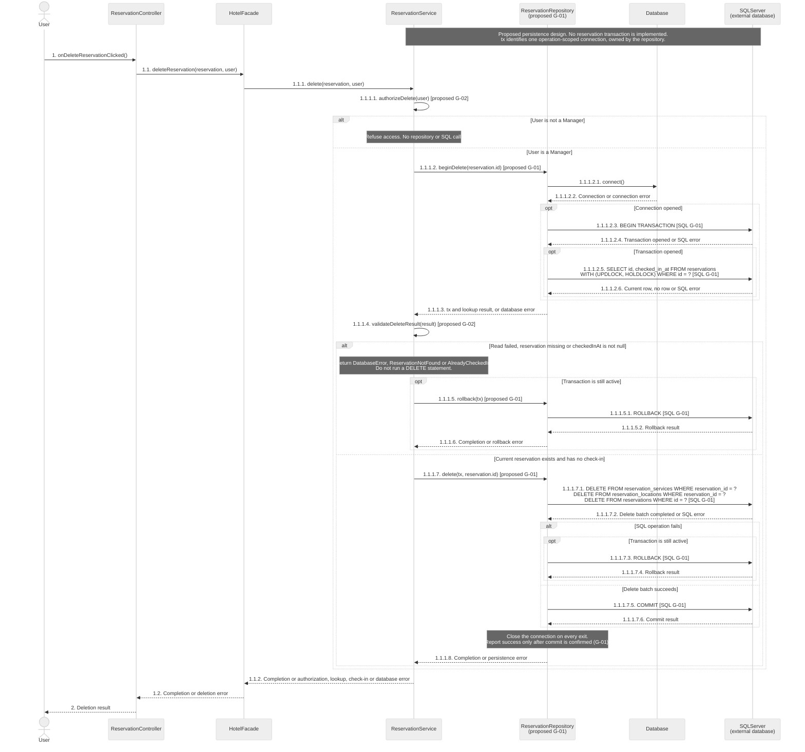
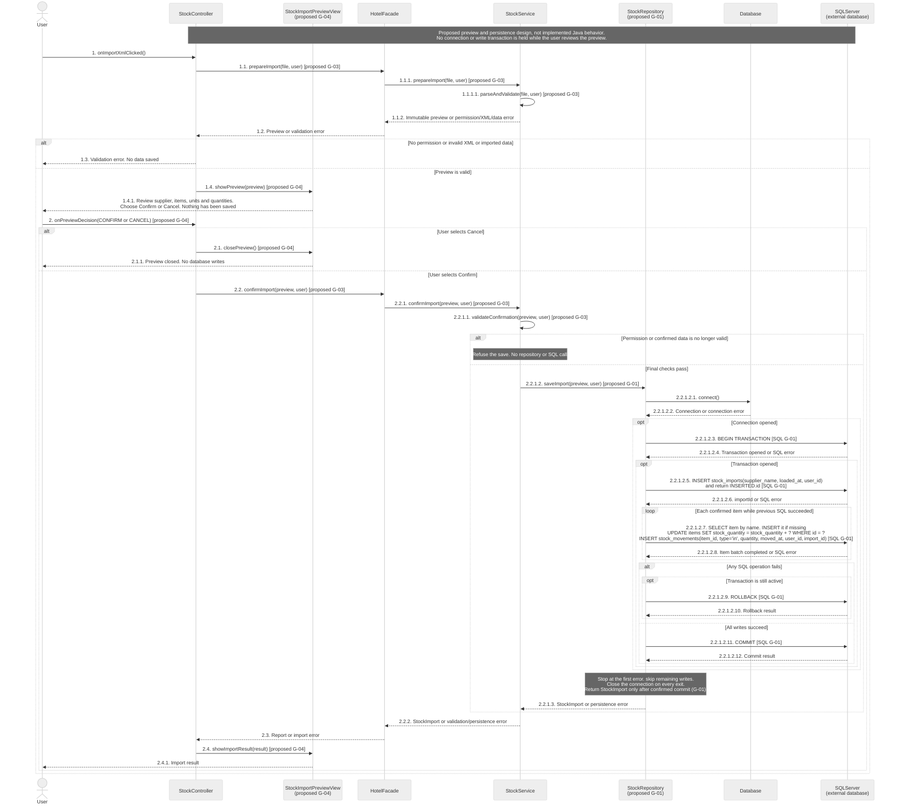

# H4Y-8 - Sequence Diagrams

These sequences refine SD-04 and SD-06. Read [sequence-guide.md](sequence-guide.md) for the decisions and the classroom explanation.

Sources: `origin/main` at `ddd8757`; [class diagram](class-diagram.md), [class methods](classes.md), [use cases](../requirements/use-cases.md), [requirements](../requirements/requirements.md) and [schema](../database/schema.md). The professor feedback supplied by the user on 2026-10-30 requires database transactions, hierarchical message numbering and XML preview with confirmation. It corrects the earlier interpretation of numbering as association cardinality.

## Reading rules

- Time goes from top to bottom. Each arrow has an explicit hierarchical message ID. No `autonumber` or numbering table is used. IDs identify the drawn messages, not a runtime counter. An alternative skips the other branch; a loop repeats its labeled interaction.
- Existing modeled calls keep their names. `[proposed G-xx]` identifies a missing class-model method. The complete receiver and signature are listed under Gaps. A dashed arrow is data, completion or an error; it does not add a method or change a modeled `void` return.
- Controllers call `HotelFacade`, which calls services. Services apply rules. Proposed repositories own database connections and transactions. Controllers never call the database.
- `Database` is the existing Java connection factory. `SQLServer` is the external database, not a Java class. Arrows marked `[SQL G-01]` summarize proposed parameterized SQL or transaction commands. They are not new methods on `Database` or executable SQL scripts.
- Both reservation and stock runtime flows are missing at this baseline. Every repository and transaction interaction below is proposed. The diagrams show the required design, not implemented persistence or tested rollback.
- Each repository operation uses one operation-scoped connection. A failed database call stops the remaining work and takes the error path. Rollback is attempted only for an active transaction. Connections must close on every exit; failure handling still needs implementation (G-01).
- SD-05 stays removed. The requested numbering is unrelated to UML association multiplicities.

## SD-04 - Detailed: delete a reservation

- **Use case:** UC-05 Delete reservation.
- **Actor:** Manager; another signed-in User takes the unauthorized branch.
- **Goal:** Delete a reservation only before check-in, using the permanent deletion required by RF-22 and Q-05.
- **Requirements:** RF-02, RF-22; RNF-07, RNF-12.
- **Status:** The controller, facade and service call names exist in the class model. The helpers, repository and transaction context are proposed (G-01, G-02).

**Required error cases:** Unauthorized user, missing reservation, any check-in history and database failure. No DELETE follows a failed role or state check. A protected card FK can make the delete batch fail; cards and access history are never deleted to force success.

The schema documents permanent deletion, not a reservation soft-delete flag. Only this reservation's extra rows, zone links and reservation row are removed. Rooms, locations and service catalogue rows stay shared. The proposed protected read and the DELETE batch use the same `tx`. Check-in must respect the same row protection before this design can be claimed safe (G-02).

A transaction protects the group of writes; a protected current-state read also prevents a concurrent check-in from invalidating the decision. These are explicit proposed database interactions, not the old combined note "check state and delete in one transaction". Connection, commit and rollback failures still need an implemented policy (G-01).

## SD-06 - General: import supplier XML

- **Use case:** UC-15 Enter supplier delivery in stock, with the preview revision requested on 2026-10-30.
- **Actor:** Signed-in hotel staff or Manager. The supplier sends the file and does not log in (Q-17).
- **Goal:** Review the validated XML, confirm it, then save the import and stock changes together.
- **Requirements:** RF-28, RF-29; RNF-07, RNF-08; new preview instruction from the professor, supplied by the user.
- **Status:** The current class model has only `importStock(file, user)`. The two-phase API, preview data, view and repository below are proposed (G-01, G-03, G-04). UC-15 still says no preview; this discrepancy is explicit in G-05.

Phase A is read-only parsing and validation. It prepares an immutable snapshot of supplier, item names, units and quantities. Phase B displays that snapshot and offers Confirm and Cancel. Phase C saves only the confirmed snapshot after final checks; it does not read the file again. Catalogue lookup is done during save, so no preview database read is needed in this design.

**Required error cases:** No permission, invalid XML or imported data, failed final validation and database failure. Cancel never calls `confirmImport` or `saveImport`. All import writes and the proposed BEGIN occur inside the Confirm branch. A connection failure does not start a transaction. A failed write must not leave partial stock, new items or an import row; that guarantee still needs code (G-01).

Unknown items are created, not rejected, under RF-28 and the retained PR #20 item rule. A new item starts with the schema's default stock quantity before the delivered quantity is added. The `stock_imports` row is created before movements use its ID. Catalogue changes, stock increments, the import and ENTRY movements share one transaction. SQL type `in` represents the model's ENTRY movement. Item lookup uses the unique `items.name`; XML name/unit matching details still need a contract (G-01, G-03).

**Contract change:** The latest preview instruction replaces the earlier no-preview workflow for this proposed sequence. It does not mean that the current UC-15 text, class diagram, JavaFX screen or two-phase API have already been updated. See G-03 to G-05.

## Message numbering

Every request, SQL command and significant response has an explicit number on its arrow. A caller's sub-call adds a level; its next interaction uses the next sibling number. Each diagram starts at `1`. SD-06 uses `2` for the user's preview decision. Alternative branches have distinct IDs, and repeated loop messages retain their static interaction IDs. No association multiplicities or separate numbering table are used.

## Traceability

| Use case | Existing modeled or implemented calls used | Proposed calls | Sources |
|----------|--------------------------------------------|----------------|---------|
| UC-05 Delete reservation | ReservationController.onDeleteReservationClicked; HotelFacade.deleteReservation; ReservationService.delete; Database.connect | ReservationService authorization/state helpers; ReservationRepository transaction and deletion methods | RF-22, Q-05; G-01, G-02 |
| UC-15 Supplier XML import, proposed preview revision | StockController.onImportXmlClicked; Database.connect | HotelFacade/StockService prepareImport and confirmImport; StockService validation helpers; StockController.onPreviewDecision; StockImportPreviewView; StockRepository.saveImport | RF-28, RF-29; professor feedback 2026-10-30; G-01, G-03 to G-05 |

## Gaps

All proposed participants and methods are named here. They are not claims about existing code or class-model methods. SQL labels are abbreviated, parameterized operation summaries supported by the schema; they are not runnable scripts. No Java code, SQL script or unrelated UML diagram changes in this task.

| ID | Missing or inconsistent contract | Proposed design and required follow-up |
|----|----------------------------------|-----------------------------------------|
| G-01 | No ReservationRepository or StockRepository, transaction context or database implementation for these flows | Proposed ReservationRepository.beginDelete(id), delete(tx, id), rollback(tx); StockRepository.saveImport(preview, user). Repositories use the existing Database.connect and own one operation-scoped connection. Define the context, parameterized statements, locking, connection closure and commit/rollback error handling before implementation. BEGIN/COMMIT/ROLLBACK are proposed database boundaries, not Database methods. |
| G-02 | Reservation runtime flow and validation helpers are missing | The three deletion call names exist only in the class model. Proposed ReservationService.authorizeDelete(user) and validateDeleteResult(result) implement RF-22 checks before writes. The protected read and deletion share tx; check-in must honor the same row protection. |
| G-03 | No two-phase XML API, immutable preview object or parser contract | Proposed HotelFacade.prepareImport(file, user), confirmImport(preview, user); StockService.prepareImport(file, user), parseAndValidate(file, user), confirmImport(preview, user), validateConfirmation(preview, user); new StockImportPreview snapshot. It must contain the reviewed data and cannot trigger a later file re-read. Confirm must recheck permission and data. Split or revise the current one-step importStock API explicitly in the class model before coding. |
| G-04 | No preview screen or decision handler | Proposed StockImportPreviewView.showPreview(preview), closePreview(), showImportResult(result), and StockController.onPreviewDecision(decision). Define the JavaFX screen with Confirm/Cancel buttons. Cancel discards the preview and never reaches persistence. No screen or Java class is created by this documentation task. |
| G-05 | Current UC-15 and class documentation still describe no preview | The 2026-10-30 instruction supplied by the user requires preview and confirmation. Current UC-15 explicitly forbids these stages and the model exposes only importStock(file, user). The proposed sequence follows the new feedback while retaining unknown-item creation. The use-case and class-model owners must align these contracts; no unrelated requirements are silently rewritten here. |

## Validation boundary

Only SD-04 and SD-06 are shown. The arrows distinguish existing modeled calls, the implemented connection factory, missing proposed APIs and external SQL operations. Preview and transactions are documentation proposals. No association-cardinality diagram or SD-05 is added. Rendering and static checks cannot establish runtime transaction safety or full Definition of Done approval.

Created by: pedrocostaisep. Updated by: pedrocostaisep. AI use: sequence-diagram-editor, OpenAI Codex (GPT-6), 2026-10-16; PR review corrections by sequence-diagram-editor, OpenAI Codex (GPT-6), 2026-10-16; doc-updater, Claude Code (claude-haiku-5-5), 2026-10-17; PR review corrections by sequence-diagram-editor, OpenAI Codex (GPT-6), 2026-10-16. teacher feedback corrections by sequence-diagram-editor, OpenAI Codex (GPT-6), 2026-10-19; PR-20 stock import review by sequence-diagram-editor, OpenAI Codex (GPT-6), 2026-10-19; sequence-only scope correction by sequence-diagram-editor, OpenAI Codex (GPT-6), 2026-10-21; PR-20 import decision review by sequence-diagram-editor, OpenAI Codex (GPT-6), 2026-10-22; merge-conflict resolution by sequence-diagram-editor, OpenAI Codex (GPT-6), 2026-10-22; carryover review by sequence-diagram-editor, OpenAI Codex (gpt-6.1-sol), 2026-10-30; clarified professor feedback by sequence-diagram-editor, OpenAI Codex (gpt-6.1-sol), 2026-10-30. Reviewed by: pending.
