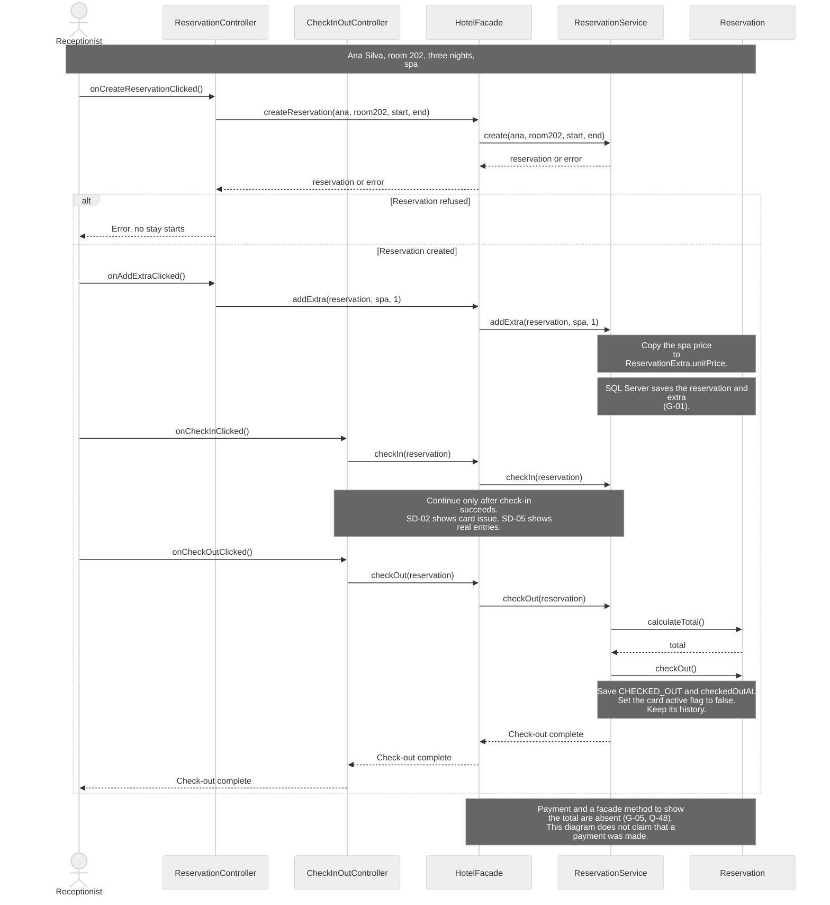
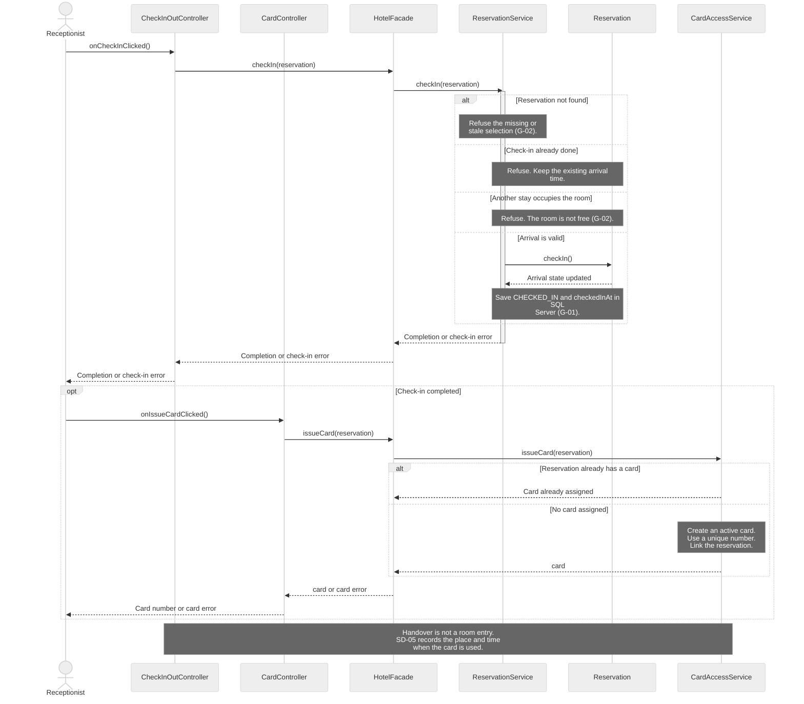
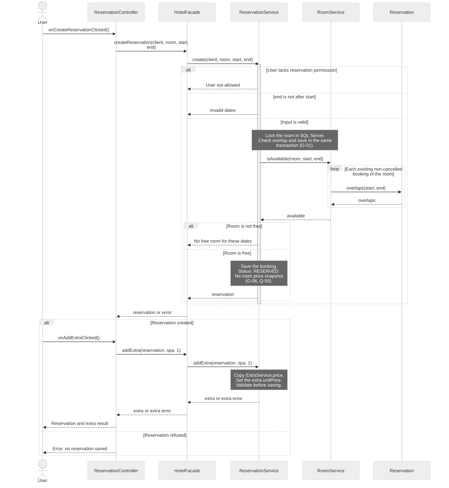
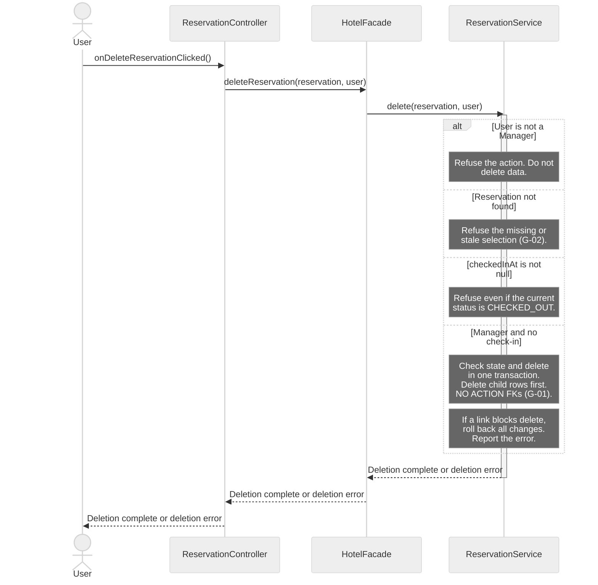
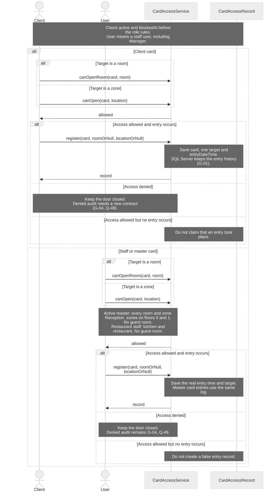
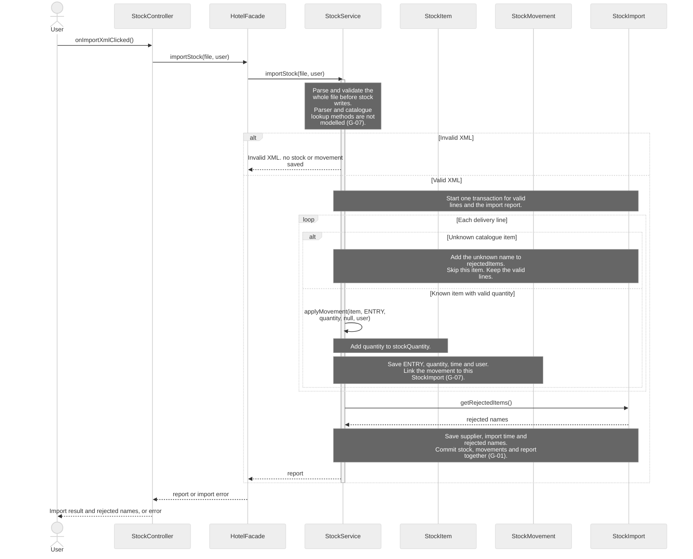

# H4Y-8 - Sequence Diagrams

These diagrams show calls between the classes in [classes.md](classes.md) and [class-diagram.md](class-diagram.md). Read [sequence-guide.md](sequence-guide.md) to explain the choices in class.

Sources: [use cases](../requirements/use-cases.md), [requirements](../requirements/requirements.md), [domain model](domain-model.md), [schema](../database/schema.md) and [table guide](../database/tables.md). The source baseline is `origin/main` at `6efffff`.

## Reading rules

- Time goes from top to bottom. Solid arrows are method calls. Dashed arrows are return values, error results or completion signals. A completion signal does not change a `void` return type.
- Each actor and participant uses a class name from the class diagram. Short IDs only make the source easier to read.
- A controller calls `HotelFacade`. The facade calls a service. Services hold business rules. Controllers never call SQL Server.
- Notes describe checks, field changes and persistence within an existing method. They are not new methods. Only the calls shown by arrows are claimed as class method coverage.
- SQL Server work appears in notes. The class model has no database or repository class with methods. See G-01.
- Each detailed diagram names one use case. SD-01 is an **ASSUMED** journey that joins existing use cases; there is no single journey use case in the source list.
- Payment, denied access audit and the room price snapshot need decisions. See Q-48 to Q-50 in [questions.md](../requirements/questions.md) and the Gaps section below.

## SD-01 - General: complete a hotel stay (ASSUMED)

- **Use case name:** Complete a hotel stay (**ASSUMED**). This overview joins UC-03 Make reservation, UC-06 Check-in and UC-07 Check-out.
- **Actor:** Receptionist.
- **Goal:** Follow Ana Silva from booking room 202 for three nights, with spa, to check-out.
- **Preconditions:** Ana is registered. Reception is signed in. The room and spa exist in the catalogue. Dates are 2026-10-20 to 2026-10-23.
- **Requirements:** RF-05, RF-06, RF-09, RF-11, RF-13, RF-14, RF-16; RNF-07, RNF-12, RNF-24.

**Error cases covered:** Reservation creation is refused. SD-02 and SD-03 expand the arrival and booking failures. Later steps run only after the previous step succeeds. No payment failure is invented.

## SD-02 - Detailed: check-in with a magnetic card

- **Use case name:** UC-06 Check-in.
- **Actor:** Receptionist.
- **Goal:** Mark arrival and issue one card for the reservation.
- **Preconditions:** Reception is signed in. A reservation is selected when it exists. A missing or stale selection must fail. Card issue starts only after a successful check-in.
- **Requirements:** RF-13, RF-16, RF-17, RF-18; RNF-07.

**Error cases covered:** Reservation not found, check-in already done, room occupied by another stay, card already assigned. Failure leaves the failed operation without a new state change. If card issue fails after check-in, do not repeat check-in; resolve the issue and retry card issue.

The occupancy check must exclude this reservation. `RoomService.isAvailable(room, start, end)` is a booking check and has no exclusion parameter. It must not reject the guest because of the guest's own booking. G-02 records the missing read and occupancy contracts.

## SD-03 - Detailed: create a reservation

- **Use case name:** UC-03 Make reservation.
- **Actor:** Receptionist. Other signed-in `User` roles exercise the permission error.
- **Goal:** Reserve a free room and add a selected extra with its price at that time.
- **Preconditions:** The client and selected room exist. The current session identifies the caller. A room selection is not proof that the room is still free.
- **Requirements:** RF-02, RF-05, RF-06, RF-07, RF-09, RF-11; RNF-07, RNF-12.

**Error cases covered:** No free room or overlap, invalid dates, user not allowed. `addExtra` also refuses invalid choices, including a second special view (Q-37). An extra failure does not claim that the already created reservation was rolled back; it can be corrected and retried before check-in.

Overlap means `start < existing.endDate` and `end > existing.startDate`. Adjacent stays do not overlap. `searchRooms(start, end, type)` can offer other rooms before this save flow. `addLocation(reservation, location)` handles restaurant and pool inclusion; paid spa is an `ExtraService`, not a card zone.

## SD-04 - Detailed: delete a reservation

- **Use case name:** UC-05 Delete reservation.
- **Actor:** Manager. Other signed-in `User` roles exercise the denied branch.
- **Goal:** Delete a reservation only before check-in.
- **Preconditions:** The caller is signed in. The selected reservation may be missing or stale. The service must check its current state.
- **Requirements:** RF-02, RF-22; RNF-07, RNF-12.

**Error cases covered:** User is not a manager, check-in already done, reservation not found, protected link or persistence failure. Deletion is permanent (Q-05). It is different from `cancel()`, which keeps the reservation in history. Neither operation is a user deactivation flag.

## SD-05 - Detailed: use a magnetic card and log entry

- **Use case name:** UC-09 Use magnetic card at a place. The restaurant staff branch also follows the existing restriction in UC-17.
- **Actor:** Client or Manager. Receptionist and RestaurantStaff are staff access variants of the same card check.
- **Goal:** Check access to a room or zone and save the place and time of a real entry.
- **Preconditions:** The card and target are known. Exactly one of `roomOrNull` and `locationOrNull` has a value. The client card links to its reservation; a staff card links to its user.
- **Requirements:** RF-17, RF-18, RF-19, RF-23, RF-24, RF-25; RNF-07.

Actor arrows below expose the existing service API. They represent the card reader boundary, not JavaFX controller calls. The reader class, door command and its orchestration are missing from the class model (G-03).

**Error cases covered:** Inactive or blocked card; another guest's room; restaurant or pool absent from the reservation; zone closed to client cards; staff floor or zone restriction. Access denied is shown. Its audit is explicitly pending: the current `register` method and `access_logs` have no outcome field. A denied attempt must not appear as a successful entry.

| Card owner | Room rule | Zone rule |
|------------|-----------|-----------|
| Client | Own reserved room only | `guestCardAccess` must be true. If `requiresReservation` is true, the reservation must include the zone. |
| Manager with master card | Every room | Every zone |
| Receptionist | No guest room | Floors 0 and 1 only |
| RestaurantStaff | No guest room | Kitchen and restaurant only |
| Any blocked or inactive card | Refuse | Refuse |

## SD-06 - Detailed: enter supplier delivery in stock

- **Use case name:** UC-15 Enter supplier delivery in stock.
- **Actor:** Receptionist or Manager. The supplier sends the file and does not log in.
- **Goal:** Import valid catalogue items, update stock and report unknown items.
- **Preconditions:** An authorised user is signed in. The XML file is available. The stock catalogue exists.
- **Requirements:** RF-28, RF-29; RNF-07, RNF-12.

**Error cases covered:** Invalid XML changes no stock. Unknown items are rejected and listed; valid items still enter stock (Q-10, Q-38). A storage failure rolls back the transaction. Quantity validation is part of parsing; a policy for invalid quantity lines needs an explicit contract (G-07), not a silent choice of partial import.

## Traceability

The lists below include each distinct call, qualified by its receiving class. Dashed responses are data, not additional methods. Each callback and method is listed in [classes.md](classes.md); exact parameters and return types are in [class-diagram.md](class-diagram.md).

| Use case | Diagram | Class methods used | Requirement IDs |
|----------|---------|--------------------|-----------------|
| Complete a hotel stay (**ASSUMED**); joins UC-03, UC-06, UC-07 | SD-01 | `ReservationController.onCreateReservationClicked`, `onAddExtraClicked`; `CheckInOutController.onCheckInClicked`, `onCheckOutClicked`; `HotelFacade.createReservation`, `addExtra`, `checkIn`, `checkOut`; `ReservationService.create`, `addExtra`, `checkIn`, `checkOut`; `Reservation.calculateTotal`, `checkOut` | RF-05, RF-06, RF-09, RF-11, RF-13, RF-14, RF-16; RNF-07, RNF-12, RNF-24 |
| UC-06 Check-in | SD-02 | `CheckInOutController.onCheckInClicked`; `CardController.onIssueCardClicked`; `HotelFacade.checkIn`, `issueCard`; `ReservationService.checkIn`; `Reservation.checkIn`; `CardAccessService.issueCard` | RF-13, RF-16, RF-17, RF-18; RNF-07 |
| UC-03 Make reservation | SD-03 | `ReservationController.onCreateReservationClicked`, `onAddExtraClicked`; `HotelFacade.createReservation`, `addExtra`; `ReservationService.create`, `addExtra`; `RoomService.isAvailable`; `Reservation.overlaps` | RF-02, RF-05, RF-06, RF-07, RF-09, RF-11; RNF-07, RNF-12 |
| UC-05 Delete reservation | SD-04 | `ReservationController.onDeleteReservationClicked`; `HotelFacade.deleteReservation`; `ReservationService.delete` | RF-02, RF-22; RNF-07, RNF-12 |
| UC-09 Use magnetic card at a place; UC-17 staff restriction | SD-05 | `CardAccessService.canOpenRoom`, `canOpen`, `register` | RF-17, RF-18, RF-19, RF-23, RF-24, RF-25; RNF-07 |
| UC-15 Enter supplier delivery in stock | SD-06 | `StockController.onImportXmlClicked`; `HotelFacade.importStock`; `StockService.importStock`, `applyMovement`; `StockImport.getRejectedItems` | RF-28, RF-29; RNF-07, RNF-12 |

## Gaps

These are class model or request gaps. No missing method is used as an arrow. Proposed contracts below need H4Y-5 review; they are not approved methods or new requirements. The source class diagram and database files are unchanged.

| ID | Gap | Effect and next step |
|----|-----|----------------------|
| G-01 | No persistence classes or methods | SQL Server has tables, but the class model has no repository, database API or transaction methods. Define read, save, delete, lock and transaction contracts before a database participant can be added. The diagrams show persistence in notes. |
| G-02 | Reservation reads and check-in occupancy are not explicit | No reservation lookup method is listed. The booking availability method cannot exclude the selected reservation. Define a fresh reservation read and an occupancy check that excludes that booking. SD-02 and SD-04 show service guards without inventing these calls. |
| G-03 | No card reader or door adapter | Define the event entry point, physical door command and the call after real entry. SD-05 exposes existing service operations at the actor boundary. It does not add a reader class or let a JavaFX controller bypass the facade. |
| G-04 | Denied access cannot be distinguished in the audit | `CardAccessRecord` and `access_logs` contain a target and entry time but no outcome. `register` accepts no outcome either. Q-49 asks whether denied attempt audit is required. If approved, define a method and data model that preserve the distinction. |
| G-05 | Payment and total display are not modelled | No payment use case, class or method exists. `Reservation.calculateTotal()` exists, but `HotelFacade.checkOut()` returns `void` and the facade has no total query. Q-48 asks for scope. SD-01 calculates a total inside the service and makes no payment claim. |
| G-06 | The requested room price snapshot is absent | The current schema computes the room part from `room_types.base_price`. Only extra prices have snapshots. Q-50 asks which rule is intended. SD-03 copies only `ExtraService.price` to `ReservationExtra.unitPrice`. |
| G-07 | XML import internals and row mapping are incomplete | No parser or catalogue lookup contract exists. `applyMovement` has no import argument; its link to the current import needs a documented contract. Invalid quantity handling is not defined. `ReservationExtra.quantity` also differs from the database's one row per service use; define this persistence mapping. |

## Validation boundary

The six diagrams can be checked for Mermaid syntax and existing method names. That does not validate an implementation. The class model does not define error types, a session API, persistence or physical reader code. Human review must accept the ASSUMED overview and decide Q-48 to Q-50 before those missing features are treated as requirements. No application run is needed for these documents.

AI use: sequence-diagram-editor, OpenAI Codex (GPT-6), 2026-10-16. Reviewed by: pending.
