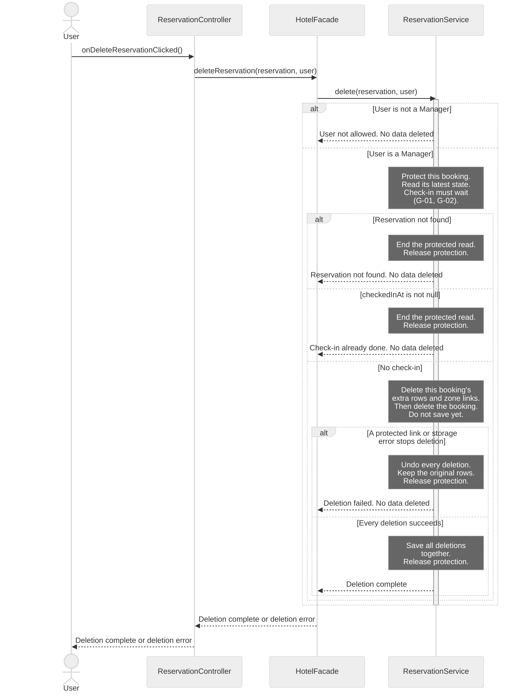
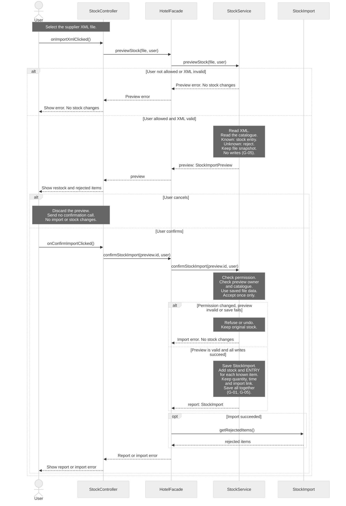

# H4Y-8 - Sequence Diagrams

These diagrams show calls between the classes in [classes.md](classes.md) and [class-diagram.md](class-diagram.md). Read [sequence-guide.md](sequence-guide.md) to explain the choices in class.

Sources: [use cases](../requirements/use-cases.md), [requirements](../requirements/requirements.md), [domain model](domain-model.md), [schema](../database/schema.md) and [table guide](../database/tables.md). The source baseline is `origin/main` at `4741c61`. The [PR #20 review](https://github.com/BorjaTiago/hotel4you/pull/20#issuecomment-6265012673) requests an XML preview, confirmation and report. It replaces the simpler SD-05 with SD-06. Diagram IDs are not reassigned.

## Reading rules

- Time goes from top to bottom. Solid arrows are method calls. Dashed arrows show data, errors or completion. A completion signal does not change a `void` return type.
- Each actor and participant uses a class name from the class diagram. Short IDs only make the source easier to read.
- A controller calls `HotelFacade`. The facade calls a service. Services hold business rules. Controllers never call SQL Server.
- Notes describe checks and data changes within an existing method. They are not new methods. Only call arrows claim method coverage.
- SQL Server work appears in notes. The class model has no database or repository class with methods. See G-01.
- Each diagram covers one existing use case. SD-04 is detailed. SD-06 is a general view of the import workflow. It keeps parsing and storage details in notes.
- The preview and confirmation calls were missing from the baseline. They are now explicit design additions in the class model, class table and G-05. They are not implemented Java methods.
- Unknown XML items remain rejected under Q-10 and Q-38. Q-51 asks whether the review intended catalogue creation. No automatic creation is assumed.
- A lifeline shows a participant in one scenario. It does not set the number of cards or records. See the cardinality review in the guide.

## SD-04 - Detailed: delete a reservation

- **Use case name:** UC-05 Delete reservation.
- **Actor:** Manager. Other signed-in `User` roles exercise the denied branch.
- **Goal:** Delete a booking and its dependent rows only before check-in.
- **Preconditions:** The caller is signed in. The selected booking may be missing or stale. The service must read its current state.
- **Requirements:** RF-02, RF-22; RNF-07, RNF-12.

**Error cases covered:** User is not a manager. The booking is missing. Check-in has occurred, including a completed stay. A protected card link or storage error stops deletion. Every failure keeps the original data.

The deletion steps are internal work of `ReservationService.delete()`. They are not extra method calls. Delete only this booking's `reservation_services` rows and `reservation_locations` links. Keep the shared room, locations and service catalogue. Never delete cards or access history to force a booking deletion.

A transaction groups the deletions: save them all, or undo them all. A lock protects the current booking while the service checks and deletes it. Check-in must respect the same protection. A transaction alone does not prevent a concurrent check-in. These persistence contracts remain G-01 and G-02. The [guide](sequence-guide.md) gives the example and failure order.

Deletion is permanent (Q-05). `cancel()` keeps the booking in history. Neither operation is a user deactivation flag.

## SD-06 - General: review and import supplier XML

- **Use case name:** UC-15 Enter supplier delivery in stock.
- **Actor:** A signed-in hotel staff user or Manager. The supplier sends the XML and does not log in (Q-17).
- **Goal:** Review a supplier file. Import valid catalogue items only after confirmation. Show the result and rejected items.
- **Preconditions:** The user selected an XML file. The stock catalogue exists (UC-19). The service must check the user's permission. A preview changes no stock.
- **Requirements:** RF-28, RF-29; RNF-07, RNF-08. Review flow: PR #20 comment. Catalogue rules: Q-10 and Q-38.

This general view shows file review, cancel, confirm and report. It does not expand the parser, catalogue queries or database writes into method calls. `StockImportPreview` holds the review data. `StockImport` is the saved import report.

The review's "new items" appear as unknown catalogue items, separate from known items for restock. They are not created or imported. This follows RF-28, Q-10 and Q-38. Creating a catalogue item is UC-19, outside this diagram. Q-51 records the possible change in that rule.

**Error cases covered:** User not allowed, including loss of permission before confirmation. Invalid XML. Unknown catalogue items. Missing, changed, foreign or already used preview. A catalogue change that makes the preview stale. A storage failure. Cancel is an alternative flow and saves nothing.

**Report:** The saved `StockImport` gives the supplier, import time and rejected items. Its ENTRY movements give the accepted item quantities. A valid file with only unknown items adds no stock and reports all items as rejected. No new catalogue item is created.

**Confirmation contract:** The preview ID refers to the exact file data held by the service, not a file path that is read again after review. The user cannot replace quantities through the screen. A changed catalogue requires a fresh preview. Confirmation saves the import, movements and balances together. It marks the preview as used only with a successful save. A second confirmation must not add stock twice. Cancel discards local review data and invokes no write. These are new documented design contracts, not implemented persistence APIs (G-05).

## Traceability

Each call below names a method of its receiving class. Dashed arrows show data, errors or completion. They are not new methods. See [classes.md](classes.md) and [class-diagram.md](class-diagram.md).

| Use case | Diagram | Class methods used | Requirement IDs |
|----------|---------|--------------------|-----------------|
| UC-05 Delete reservation | SD-04 (detailed) | `ReservationController.onDeleteReservationClicked`; `HotelFacade.deleteReservation`; `ReservationService.delete` | RF-02, RF-22; RNF-07, RNF-12 |
| UC-15 Enter supplier delivery in stock | SD-06 (general, preview, cancel, confirm and report) | `StockController.onImportXmlClicked`, `onConfirmImportClicked`; `HotelFacade.previewStock`, `confirmStockImport`; `StockService.previewStock`, `confirmStockImport`; `StockImport.getRejectedItems` | RF-28, RF-29; RNF-07, RNF-08 |

## Gaps

These contracts need team review. No absent method is used as a call arrow. G-05 names the new class model contracts added with the PR review. They remain unimplemented. The cardinality corrections are documented in the [guide](sequence-guide.md#cardinality-review).

| ID | Gap | Effect and next step |
|----|-----|----------------------|
| G-01 | No persistence classes or methods | Define protected reads, save, delete and transaction contracts. SD-04 needs all deletions saved together or fully undone. Check-in and deletion must respect the same booking lock. SD-06 needs the import, ENTRY movements and stock balances saved together. |
| G-02 | The current reservation read is not explicit | Read the booking after acquiring protection. Keep that protection until save or undo finishes. If check-in finishes first, the read must see it and refuse deletion. Do not invent a lookup or lock method. |
| G-03 | No card reader or door adapter | Retained outside the current two diagrams. Define the reader event, door command and event after real entry before card implementation. JavaFX controllers must still use the facade. |
| G-04 | Denied audit has no outcome | `CardAccessRecord` and `access_logs` lack an outcome. `register()` accepts none. Q-49 asks whether denied attempts need audit. An approved contract must distinguish refusals from entries. |
| G-05 | The baseline lacked XML review and confirmation | This change adds `StockImportPreview`, `StockController.onConfirmImportClicked`, and `previewStock` / `confirmStockImport` to `HotelFacade` and `StockService` in the class documents. H4Y-5 review and implementation must define snapshot storage, owner checks, catalogue revalidation, one-time confirmation and atomic writes. Do not claim these methods already exist in Java. Q-51 keeps catalogue creation outside this design. |

## Validation boundary

There are two diagrams: SD-04 detailed and SD-06 general. SD-05 is replaced after PR review. Cardinality is reviewed in the guide. The database documents still express the existing one-card-per-reservation rule. No database script or application code implements these changes in this task. Persistence, preview and physical reader contracts remain incomplete. Q-49 and Q-51 stay open. Human review is required.

Created by: pedrocostaisep. Updated by: pedrocostaisep. AI use: sequence-diagram-editor, OpenAI Codex (GPT-6), 2026-10-16; PR review corrections by sequence-diagram-editor, OpenAI Codex (GPT-6), 2026-10-16. teacher feedback corrections by sequence-diagram-editor, OpenAI Codex (GPT-6), 2026-10-19; PR-20 stock import review by sequence-diagram-editor, OpenAI Codex (GPT-6), 2026-10-19. Reviewed by: pending.
