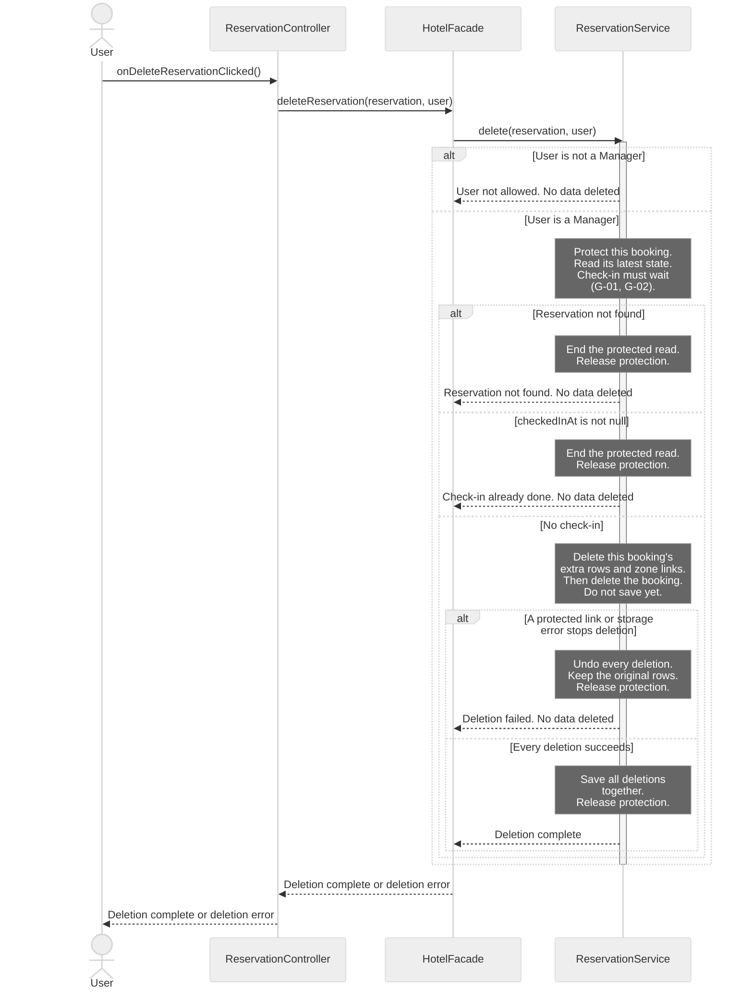
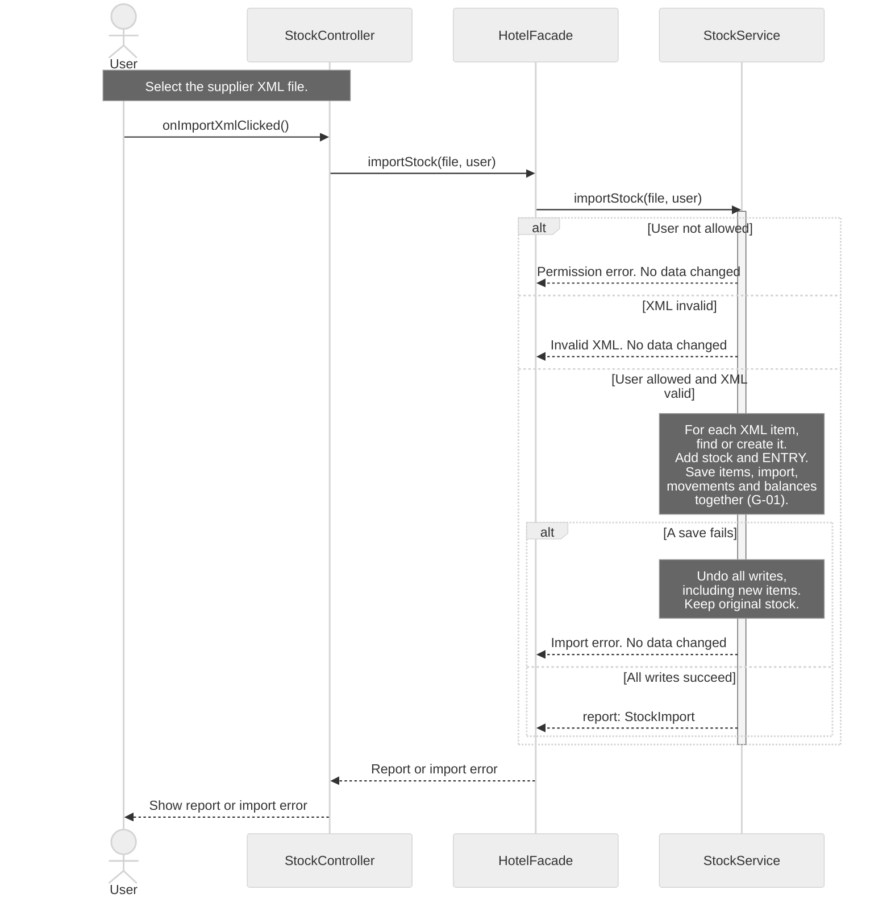

# H4Y-8 - Sequence Diagrams

These diagrams show calls between the classes in [classes.md](classes.md) and [class-diagram.md](class-diagram.md). Read [sequence-guide.md](sequence-guide.md) to defend the flows and their limits.

Sources: [use cases](../requirements/use-cases.md), [requirements](../requirements/requirements.md), [domain model](domain-model.md), [schema](../database/schema.md) and [table guide](../database/tables.md). The source baseline is `origin/main` at `4741c61`. The latest [PR #20 decision](https://github.com/BorjaTiago/hotel4you/pull/20#issuecomment-6322549129), dated 2026-10-21, replaces the earlier preview request: import all items from a valid XML file and create missing catalogue items. SD-06 replaces the simpler SD-05 card flow. Diagram IDs are not reassigned.

## Reading rules

- Time goes from top to bottom. Solid arrows are method calls. Dashed arrows show data, errors or completion. A completion signal does not change a `void` return type.
- Each actor and participant uses a class name from the class diagram. Short IDs only make the source easier to read.
- A controller calls `HotelFacade`. The facade calls a service. Services hold business rules. Controllers never call SQL Server.
- Notes describe internal work or an explicitly marked missing contract. They are not new methods. Only call arrows claim method coverage.
- SQL Server work appears in notes. The class model has no database or repository class with methods. See G-01.
- Each diagram covers one existing use case. SD-04 is detailed. SD-06 is a general view of the import workflow. It keeps parsing and storage details in notes.
- SD-06 uses the existing one-step `importStock()` API. It has no preview or confirmation stage.
- The latest PR decision accepts every item from a valid XML file, including items missing from the catalogue. This replaces the earlier unknown-item rejection rule for this flow.
- A lifeline shows a participant in one scenario. It does not set the number of cards or records. See the cardinality review below.

## SD-04 - Detailed: delete a reservation

- **Use case name:** UC-05 Delete reservation.
- **Actor:** Manager. Other signed-in `User` roles exercise the denied branch.
- **Goal:** Delete a booking and its dependent rows only before check-in.
- **Preconditions:** The caller is signed in. The selected booking may be missing or stale. The service must read its current state.
- **Requirements:** RF-02, RF-22; RNF-07, RNF-12.

**Error cases covered:** User is not a manager. The booking is missing. Check-in has occurred, including a completed stay. A protected card link or storage error stops deletion. Every failure keeps the original data.

The deletion steps are internal work of `ReservationService.delete()`. They are not extra method calls. Delete only this booking's `reservation_services` rows and `reservation_locations` links. Keep the shared room, locations and service catalogue. Never delete cards or access history to force a booking deletion.

A transaction groups the deletions: save them all, or undo them all. A lock protects the current booking while the service checks and deletes it. Check-in must respect the same protection. A transaction alone does not prevent a concurrent check-in. These persistence contracts remain G-01 and G-02.

Example: booking R17 has two extra rows and one pool link. Success deletes those three rows and the booking together. The room, pool and service catalogue remain. If the booking delete fails, undo all four deletions. Release the booking protection only after save or undo finishes.

Deletion is permanent (Q-05). `cancel()` keeps the booking in history. Neither operation is a user deactivation flag.

## SD-06 - General: import supplier XML

- **Use case name:** UC-15 Enter supplier delivery in stock.
- **Actor:** A signed-in hotel staff user or Manager. The supplier sends the XML and does not log in (Q-17).
- **Goal:** Import every item from a valid supplier XML file. Create missing catalogue items, update stock and show the report.
- **Preconditions:** The user selected an XML file and is signed in. The service must check permission and validate the XML before writing stock.
- **Requirements:** RF-28, RF-29; RNF-07, RNF-08. Updated import rule: PR #20 decision, 2026-10-21.

This general view shows file selection, one import call and the result. `StockService` reads the XML and finds or creates each catalogue item. Every item in a valid file enters stock. Missing catalogue items are not rejected. Catalogue matching, item creation and database writes remain internal notes. They do not add API methods.

**Error cases covered:** User not allowed. Invalid XML. A storage failure. Each error leaves the original stock unchanged. A save failure also undoes catalogue items created by this import.

**Report:** The result identifies the supplier and import time. Linked ENTRY movements record every imported item and quantity. The class, domain and database documents no longer keep a rejected-item list.

Example: soap has balance 10. The XML contains soap +5 and a new catalogue item, towels +3. Success leaves soap at 15, creates towels with balance 3, and saves two ENTRY movements linked to one import. A failed save leaves soap at 10 and removes the towels item created by that failed import.

## Cardinality review

These counts describe the existing UML model. A sequence lifeline represents one participant in the scenario, not the number of stored objects. The review changes no class association, database constraint or index.

| Relationship | Existing multiplicity | Effect on the sequence |
|--------------|-----------------------|------------------------|
| Reservation and ReservationExtra | One booking has `0..*` extra rows; each row has one booking. | SD-04 removes the selected booking's rows only. |
| Reservation and Location | `0..*` on both sides, through link rows. | SD-04 removes links, not shared locations. |
| Reservation and MagneticCard | `0..1` on both sides in UML. | SD-04 does not delete a card to bypass a protected link. |
| StockItem and StockMovement | One item per movement; `0..*` movements per item. | Each XML item adds an ENTRY movement, including an item created during import. |
| StockImport and StockMovement | `0..*` movements per import; `0..1` import per movement. | XML movements share one import. A manual movement can have no import link. |
| User and StockImport | One user per import; `0..*` imports per user. | The supplier does not log in. The authorized hotel user records the import. |

## Traceability

Each call below names a method of its receiving class. Dashed arrows show data, errors or completion. They are not new methods. See [classes.md](classes.md) and [class-diagram.md](class-diagram.md).

| Use case | Diagram | Class methods used | Requirement IDs |
|----------|---------|--------------------|-----------------|
| UC-05 Delete reservation | SD-04 (detailed) | `ReservationController.onDeleteReservationClicked`; `HotelFacade.deleteReservation`; `ReservationService.delete` | RF-02, RF-22; RNF-07, RNF-12 |
| UC-15 Enter supplier delivery in stock | SD-06 (general, XML selection, import and report) | `StockController.onImportXmlClicked`; `HotelFacade.importStock`; `StockService.importStock` | RF-28, RF-29; RNF-07, RNF-08 |

## Gaps

These persistence contracts need team review. No absent method is used as a call arrow. The card-reader and denied-audit gaps are outside these diagrams and are removed from this table. Q-49 remains open in the question list. The preview gap is no longer needed under the latest import decision.

| ID | Gap | Effect and next step |
|----|-----|----------------------|
| G-01 | No persistence classes or methods | Define protected reads, save, delete and transaction contracts. SD-04 needs all deletions saved together or fully undone. Check-in and deletion must respect the same booking lock. SD-06 needs new catalogue items, the import, ENTRY movements and stock balances saved together or fully undone. |
| G-02 | The current reservation read is not explicit | Read the booking after acquiring protection. Keep that protection until save or undo finishes. If check-in finishes first, the read must see it and refuse deletion. Do not invent a lookup or lock method. |

## Validation boundary

There are two diagrams: SD-04 detailed and SD-06 general. SD-05 is replaced after PR review. All call arrows use public methods already in the class model. No new preview or confirmation API is needed. Persistence contracts remain incomplete. Q-49 stays open outside these diagrams. Human review is required.

Created by: pedrocostaisep. Updated by: pedrocostaisep. AI use: sequence-diagram-editor, OpenAI Codex (GPT-6), 2026-10-16; PR review corrections by sequence-diagram-editor, OpenAI Codex (GPT-6), 2026-10-16. teacher feedback corrections by sequence-diagram-editor, OpenAI Codex (GPT-6), 2026-10-19; PR-20 stock import review by sequence-diagram-editor, OpenAI Codex (GPT-6), 2026-10-19; sequence-only scope correction by sequence-diagram-editor, OpenAI Codex (GPT-6), 2026-10-21; PR-20 import decision review by sequence-diagram-editor, OpenAI Codex (GPT-6), 2026-10-22. Reviewed by: pending.
