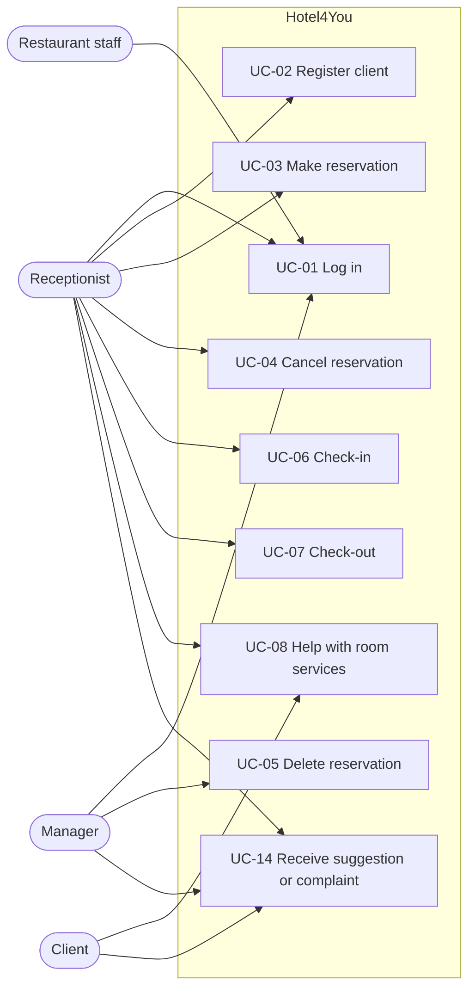
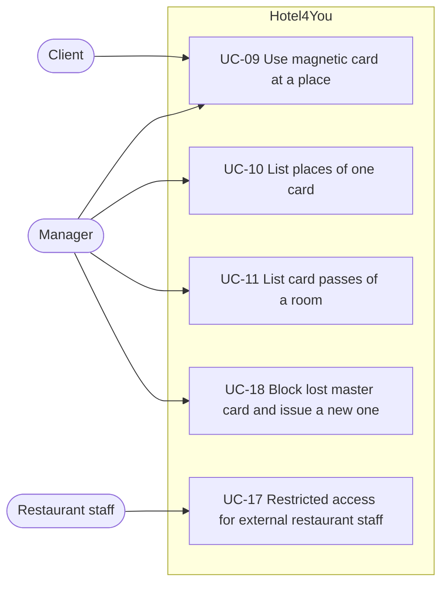
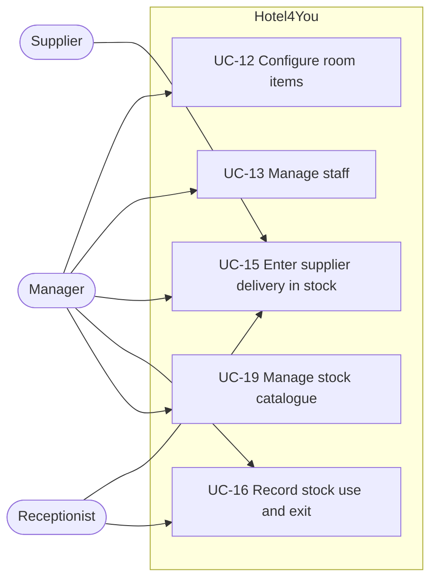

# Use-case diagrams

The diagrams show every project actor and all 19 use cases from the requirements. Each use case links to at least one actor. The [catalogue](use-case-catalog.md) gives the short description, permission rules, and requirement references.

## Reservations and guest services

## Cards and restricted access

## Room configuration and stock

AI use: OpenAI Codex, GPT-6, 2026-10-16; edited by OpenAI Codex, GPT-6, 2026-10-16. Reviewed by: pending.
