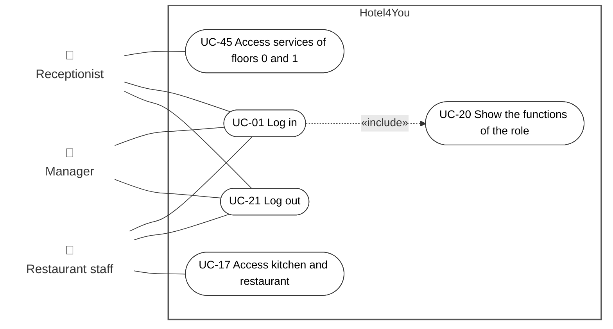
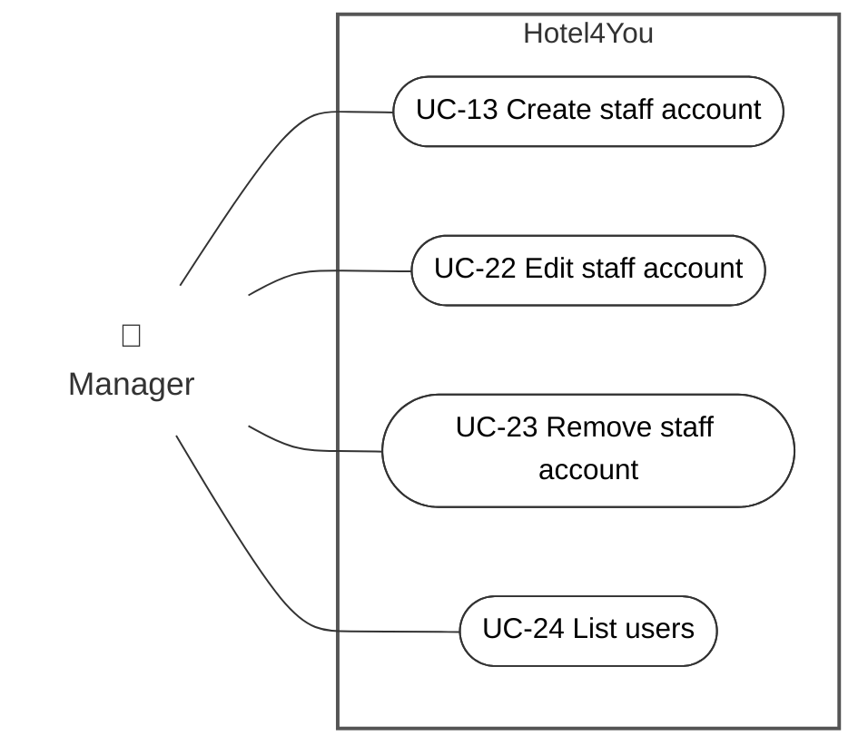
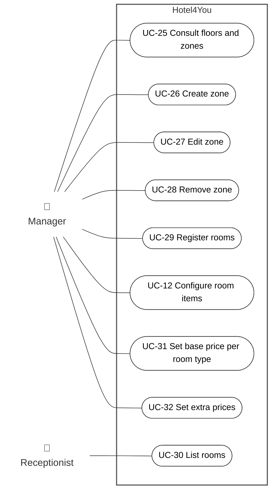
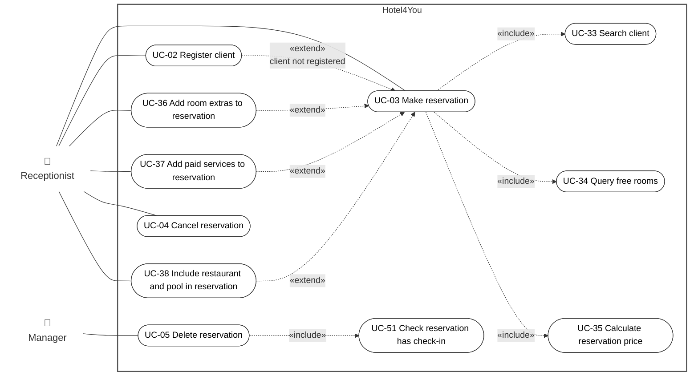
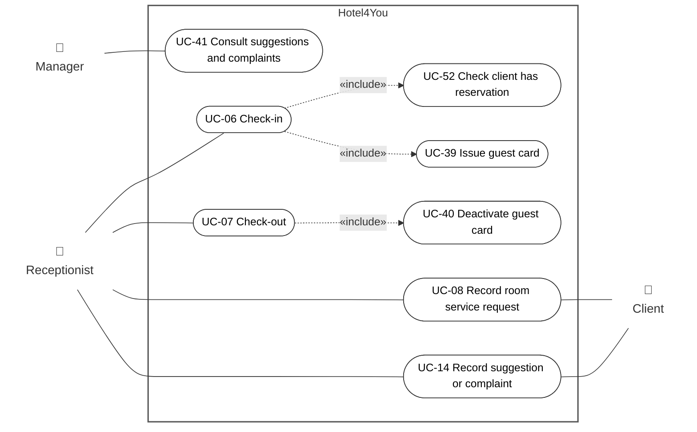
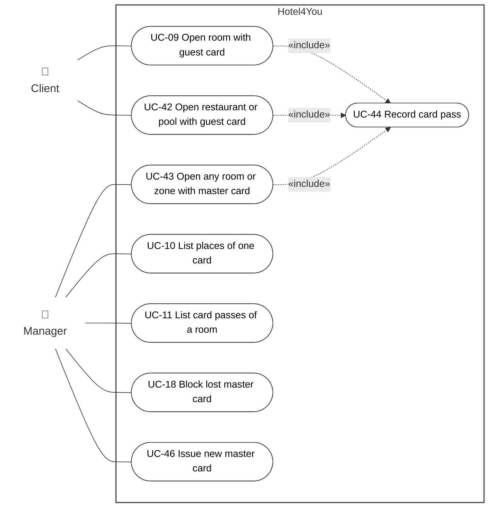
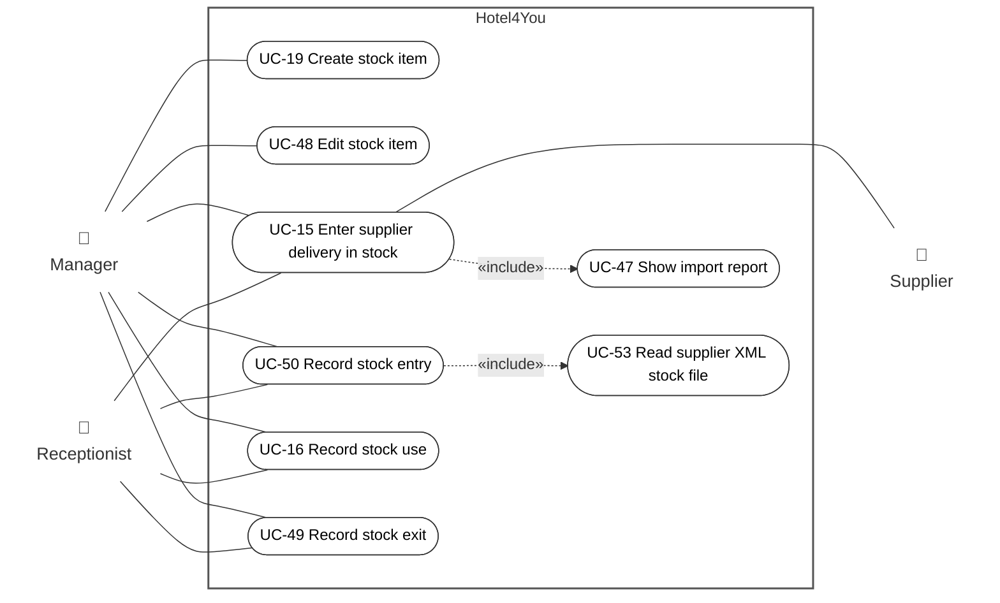

# Use-case diagrams

Hotel4You has 5 actors and 53 use cases. The overview table shows which actor takes part in each functional area. Seven diagrams show each area in detail (area 1 has two diagrams). The [catalogue](use-case-catalog.md) gives the short description, the permission rules and the requirement links of each use case. The flows are in [../requirements/use-cases.md](../requirements/use-cases.md).

Review for H4Y-7 (teacher feedback, sprint 2): the old diagrams had 19 large use cases. The review splits them into the real user goals, adds the missing use cases, and adds the `«include»` and `«extend»` relations.

Sprint 2 retrospective fixes for H4Y-7 (sprint 3): UC-51 (included in UC-05), UC-52 (included in UC-06) and UC-53 (included in UC-50).

## Notation

| Element | UML meaning | Mermaid form |
|---------|-------------|--------------|
| Person symbol and name, outside the box | Actor | Node with no border |
| Rounded box (stadium) | Use case. Mermaid has no UML ellipse, so the stadium shape is used. | `UC01(["UC-01 Log in"])` |
| Large box with the title "Hotel4You" | System boundary | `subgraph` |
| Solid line, no arrow | Association: the actor takes part in the use case | `---` |
| Dashed arrow `«include»` | The base use case always runs the included use case | `-.->` from base to included |
| Dashed arrow `«extend»` | The extending use case adds optional behavior to the base use case | `-.->` from extending to base |

Reading rules:

- Primary actors (they start the use case) are on the left. Secondary actors (they take part, but do not use the application) are on the right.
- An included use case is linked to its actors through its base use case.
- Some diagrams have an invisible link (`~~~`). It only keeps a primary actor on the left or a secondary actor on the right. It has no UML meaning.
- The client does not log in (Q-13). The client uses the magnetic card, and asks reception for services. The supplier does not log in (Q-17). The supplier only sends the XML file.

## Overview

The table shows which actor takes part in each area. "P" = primary actor (starts the use case). "S" = secondary actor (takes part, does not use the application).

| Area (diagram) | Use cases | Receptionist | Manager | Restaurant staff | Client | Supplier |
|----------------|-----------|:---:|:---:|:---:|:---:|:---:|
| 1. Access and staff accounts | UC-01, UC-13, UC-17, UC-20 to UC-24, UC-45 | P | P | P | | |
| 2. Hotel structure and prices | UC-12, UC-25 to UC-32 | P | P | | | |
| 3. Clients and reservations | UC-02 to UC-05, UC-33 to UC-38, UC-51 | P | P | | | |
| 4. Stay and guest services | UC-06 to UC-08, UC-14, UC-39 to UC-41, UC-52 | P | P | | S | |
| 5. Magnetic cards | UC-09 to UC-11, UC-18, UC-42 to UC-44, UC-46 | | P | | P | |
| 6. Stock | UC-15, UC-16, UC-19, UC-47 to UC-50, UC-53 | P | P | | | S |

## 1. Access and staff accounts

### 1a. Session and place access

### 1b. Staff accounts

## 2. Hotel structure and prices

## 3. Clients and reservations

UC-36, UC-37 and UC-38 extend UC-03 when the receptionist creates the reservation. The receptionist can also start them alone, to change an existing reservation until check-in (Q-40). For this reason they also have a direct association.

UC-05 always includes UC-51. The system checks if the reservation has a check-in. If it has a check-in, the system refuses the delete (RF-22).

## 4. Stay and guest services

The client is a secondary actor in UC-08 and UC-14. The client asks reception. The receptionist records the request in the application (Q-18, Q-33).

UC-06 always includes UC-52. The system checks if the client has a reservation. Without a reservation, the system refuses the check-in (RF-13).

## 5. Magnetic cards

UC-46 has a precondition: the old master card is blocked first with UC-18 (Q-31). A manager created later also gets a master card with UC-46 (Q-44).

## 6. Stock

The supplier is a secondary actor in UC-15. The supplier sends the XML file. The receptionist or the manager loads it (Q-17).

UC-50 always includes UC-53. The supplier XML stock file gives the stock entry (RF-28).

## Changes from the first version

| Old use case | New use cases |
|--------------|---------------|
| UC-01 Log in | UC-01 Log in, UC-20 Show the functions of the role (included), UC-21 Log out |
| UC-03 Make reservation | UC-03 Make reservation, with UC-33, UC-34, UC-35 (included) and UC-02, UC-36, UC-37, UC-38 (extend) |
| UC-06 Check-in | UC-06 Check-in, UC-39 Issue guest card (included) |
| UC-07 Check-out | UC-07 Check-out, UC-40 Deactivate guest card (included) |
| UC-08 Help with room services | UC-08 Record room service request |
| UC-09 Use magnetic card at a place | UC-09 Open room with guest card, UC-42, UC-43, UC-44 Record card pass (included) |
| UC-13 Manage staff | UC-13 Create staff account, UC-22 Edit, UC-23 Remove, UC-24 List users |
| UC-14 Receive suggestion or complaint | UC-14 Record suggestion or complaint, UC-41 Consult suggestions and complaints |
| UC-15 Enter supplier delivery in stock | UC-15, UC-47 Show import report (included) |
| UC-16 Record stock use and exit | UC-16 Record stock use, UC-49 Record stock exit, UC-50 Record stock entry |
| UC-17 Restricted access for external restaurant staff | UC-17 Access kitchen and restaurant, UC-45 Access services of floors 0 and 1 |
| UC-18 Block lost master card and issue a new one | UC-18 Block lost master card, UC-46 Issue new master card |
| UC-19 Manage stock catalogue | UC-19 Create stock item, UC-48 Edit stock item |
| (missing) | UC-25 to UC-32: floors, zones, rooms and prices |

UC-02, UC-04, UC-05, UC-10, UC-11 and UC-12 keep their name. The IDs UC-01 to UC-19 do not change, because the sequence diagrams and the requirements use them.

Created by: antonioprmartinho. Updated by: antonioprmartinho. AI use: OpenAI Codex, GPT-6, 2026-10-16; edited by OpenAI Codex, GPT-6, 2026-10-16; ellipse use-case and actor-symbol notation update by OpenAI Codex, GPT-6, 2026-10-16; H4Y-7 review (split and new use cases, include and extend relations, overview diagram) by use-case-diagram-editor, Claude Code (claude-opus-5-5), 2026-10-23; H4Y-7 retrospective fixes (UC-51, UC-52, UC-53) by use-case-diagram-editor, Claude Code (claude-opus-5-5), 2026-10-29. Reviewed by: pending.
